# Laporan perorangan — Salavi Naharani (124450090), komponen Profil dan Pembersihan

## 1. Komponen saya

Saya bertanggung jawab pada komponen Profil dan Pembersihan dalam pipeline Data Wrangling. Tugas saya meliputi penyusunan profil statistik data, identifikasi calon anomali, pemeriksaan data hilang dan patahan seri, serta pencatatan keputusan pembersihan berdasarkan karakteristik dan metadata data BPS.

## 2. Keputusan wrangling

Pada tahap profiling, saya menggunakan metode Interquartile Range (IQR) untuk mengidentifikasi calon anomali pada enam seri data BPS, yaitu 845, 847, 1273, 2179, 2741, dan 2749. Perhitungan IQR dilakukan berdasarkan gabungan nilai antarprovinsi dan tahun untuk setiap seri serta kategori detail.

Hasil pemeriksaan menemukan 49 calon anomali. Nilai tersebut tidak langsung dihapus atau diubah karena hasil deteksi statistik belum membuktikan adanya kesalahan pencatatan. Alternatif menghapus seluruh nilai di luar batas IQR ditolak karena dapat menghilangkan variasi data yang sebenarnya mencerminkan kondisi wilayah.

Keputusan pada tahap ini adalah mempertahankan nilai asli dan mencatatnya sebagai calon anomali untuk pemeriksaan lebih lanjut. Dengan demikian, tidak ada nilai yang dikoreksi atau dihapus akibat deteksi IQR.

Keputusan penggunaan IQR dicatat dalam log-keputusan.csv dengan ID K-002 sampai K-007 untuk seri 845, 847, 1273, 2179, 2741, dan 2749. Tidak ada baris yang dihapus atau nilai yang dikoreksi berdasarkan hasil deteksi IQR.

## 3. Kegagalan dan pelajaran

Saat menjalankan skrip profiling secara langsung menggunakan perintah `python reports\profil_anomali_bps.py`, terjadi kegagalan `ModuleNotFoundError: No module named 'src'`. Hal ini terjadi karena modul proyek tidak ditemukan ketika skrip dijalankan secara langsung dari lokasi tersebut.

Perbaikan dilakukan dengan menjalankan skrip sebagai modul menggunakan perintah `python -m reports.profil_anomali_bps`. Setelah menggunakan cara tersebut, proses ekstraksi, profiling, identifikasi calon anomali, dan pembuatan grafik berhasil dijalankan.

Pelajaran yang diperoleh adalah cara menjalankan skrip perlu memperhatikan struktur paket dan lokasi modul dalam proyek.

## 4. Bukti

Berikut perbandingan jumlah data sebelum dan sesudah proses pemilihan data untuk analisis profiling.

| Ukuran | Sebelum | Sesudah | Perintah |
|---|---:|---:|---|
| Jumlah data enam seri BPS | 3.058 baris | 2.967 baris | Skrip `reports.profil_anomali_bps.py` |
| Calon anomali IQR | Belum diidentifikasi | 49 baris | Skrip `reports.profil_anomali_bps.py` |
| Grafik | Belum dibuat | 12 grafik | Skrip `reports.profil_anomali_bps.py` |

Catatan: jumlah 2.967 merupakan data yang digunakan untuk analisis setelah pemilihan enam seri, pengeluaran wilayah agregat Indonesia, dan penyaringan nilai, tahun, serta nama wilayah yang tidak tersedia. Tahap ini merupakan penyaringan untuk analisis, bukan penghapusan data mentah.

Perintah untuk menghasilkan ulang tabel profil, daftar calon anomali, dan grafik:

```powershell
.\.venv\Scripts\python.exe -m reports.profil_anomali_bps
```

Hasil profiling disimpan dalam:
- `reports/profil_statistik_bps.csv`
- `reports/profil_per_provinsi_bps.csv`
- `reports/calon_anomali_bps.csv`

Grafik disimpan dalam folder `reports/gambar/`.

### Temuan cakupan dan metadata

1. Seri 845 memiliki data tahun 1993–2010 dan 2021–2025. Metadata mencatat perubahan rumus pada 2011 serta keterbatasan cakupan beberapa wilayah pada tahun-tahun awal.
2. Seri 847 tidak memiliki data tahun 2005. Metadata mencatat perubahan konsep sejak 2019.
3. Seri 1273 tersedia pada 2016–2025. Metadata menjelaskan bahwa pertanyaan mengenai fasilitas cuci tangan pertama kali ditanyakan pada Susenas MKP 2016.
4. Seri 2179 tersedia pada 2020–2025 dan memiliki tiga kategori detail, yaitu Perkotaan, Perdesaan, dan Perkotaan+Perdesaan.
5. Seri 2741 tersedia pada 2020–2025.
6. Seri 2749 tersedia pada 2024–2025. Papua Pegunungan tidak tercatat pada kedua tahun tersebut sehingga ditandai sebagai temuan cakupan yang perlu ditelusuri lebih lanjut.

### Grafik hasil profiling

**Boxplot**

- 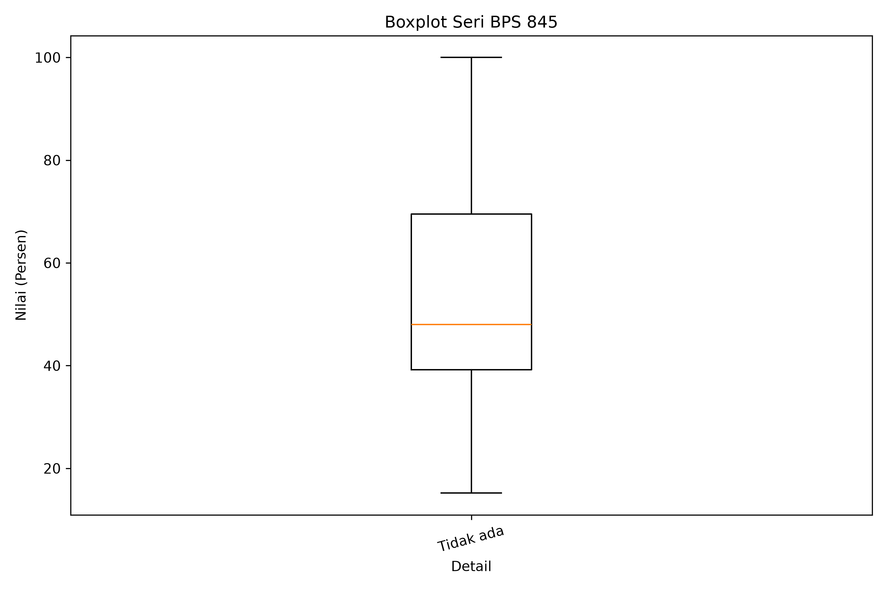
- 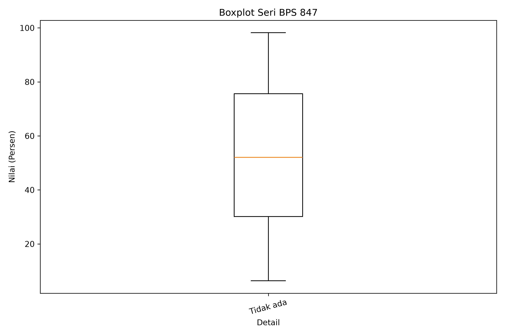
- 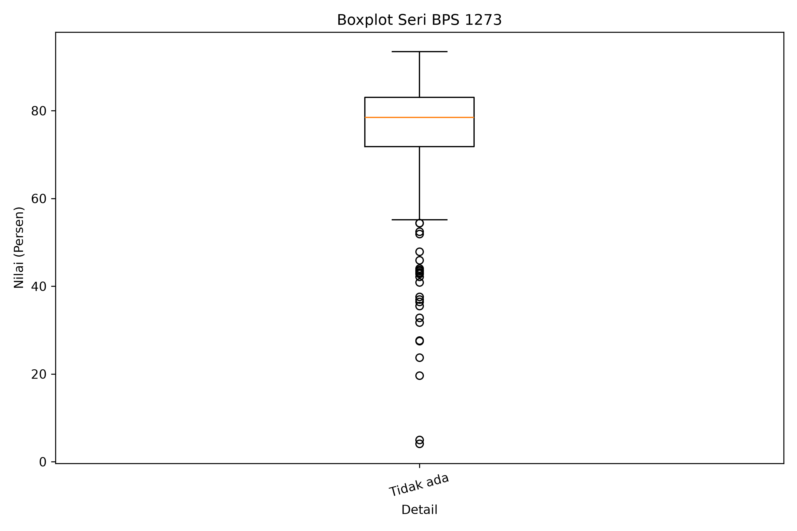
- 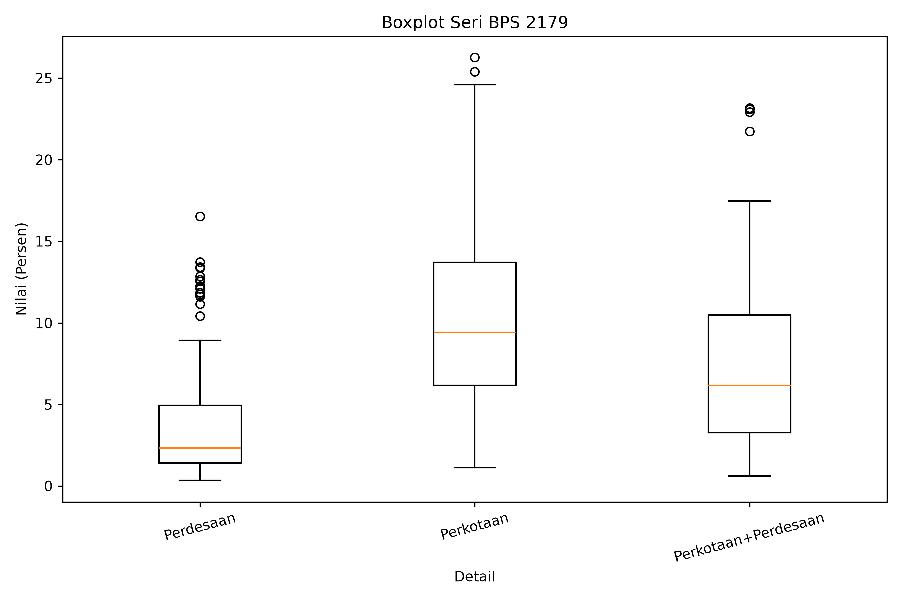
- 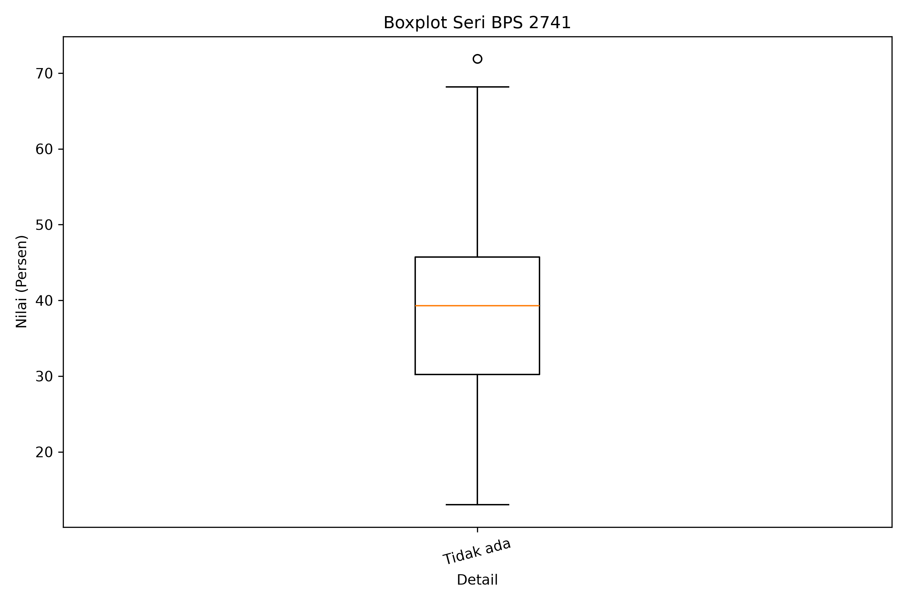
- 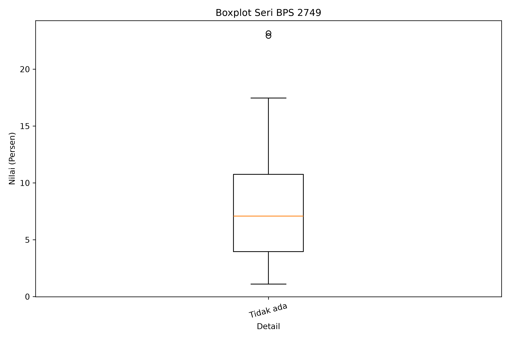

**Time series**

- 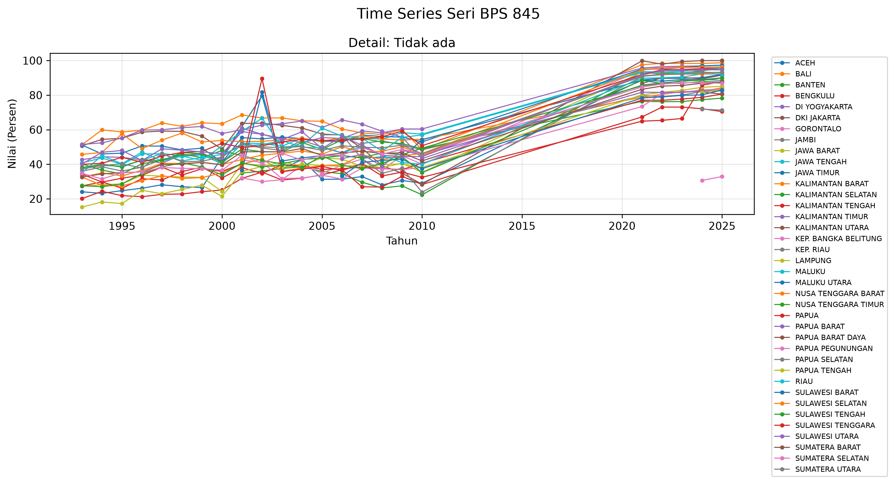
- 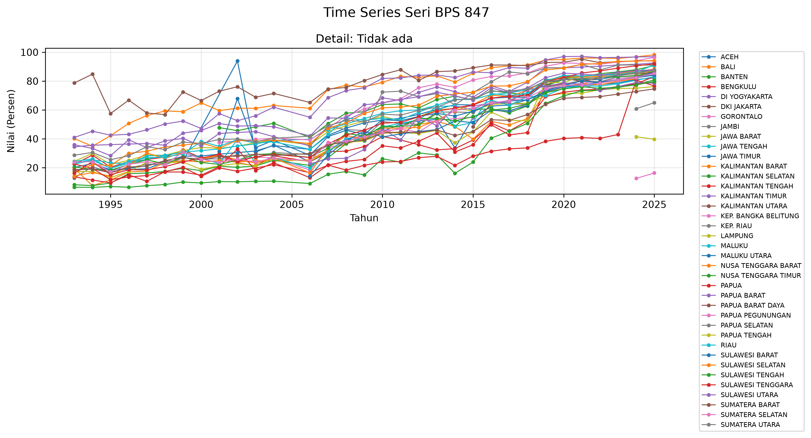
- 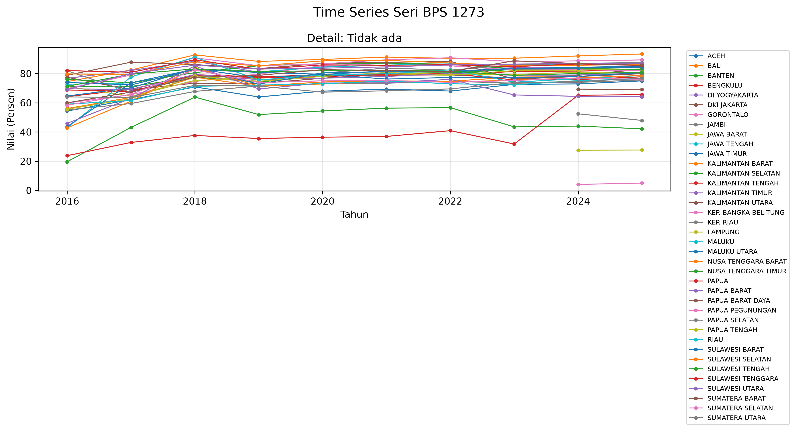
- 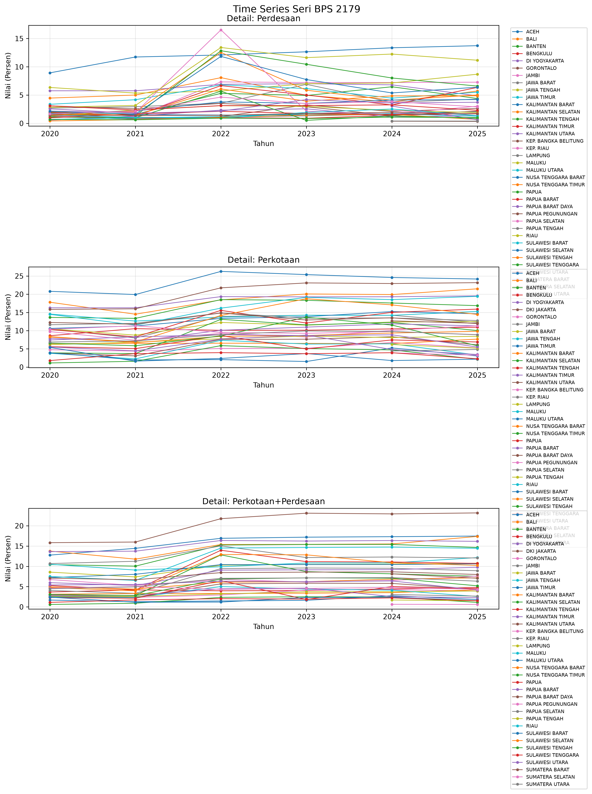
- 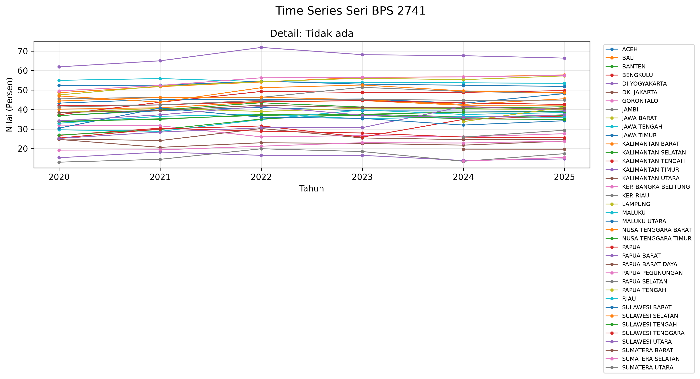
- 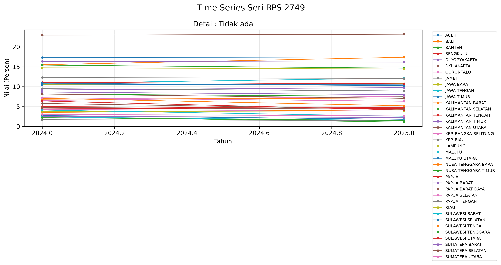

## 5. Yang akan saya ubah jika ada satu sprint lagi

Jika memiliki satu sprint tambahan, saya akan memperdalam pemeriksaan calon anomali dengan membandingkan pola antarwaktu dan antarwilayah. Saya juga akan menelusuri metadata untuk memastikan perubahan definisi, metode pengumpulan, dan cakupan wilayah pada setiap seri. Selain itu, saya akan meningkatkan keterbacaan grafik time series agar pola setiap provinsi lebih mudah diamati. Terakhir, saya akan memperjelas dokumentasi keputusan wrangling dan menghubungkannya dengan log keputusan tim.