# Profil dan calon anomali seri utama

Dihasilkan `python pipeline.py` (`src/silver/profil.py`). Hanya baris provinsi deret utama (rincian `total`, atau rincian yang didaftar di `DERET` untuk seri yang terbit per rincian; label `kode [rincian]`); baris Indonesia ditampilkan terpisah dan tidak ikut statistik antarprovinsi.

## Banyak periode per provinsi (menentukan arah pembanding)

| seri_kode | min_periode_per_provinsi | maks_periode_per_provinsi |
|---|---|---|
| var1273 | 2 | 10 |
| var2179 | 2 | 6 |
| var2741 | 2 | 6 |
| var2749 | 2 | 2 |
| var845 | 2 | 23 |
| var847 | 2 | 32 |

- var1273: tiga arah (periode per provinsi 2–10)
- var2179: tiga arah (periode per provinsi 2–6)
- var2741: tiga arah (periode per provinsi 2–6)
- var2749: hanya arah ke bawah dan perubahan (periode per provinsi 2–2)
- var845: tiga arah (periode per provinsi 2–23)
- var847: tiga arah (periode per provinsi 2–32)

Metode: IQR dengan pengali 1.5; arah ke samping hanya bila satu provinsi punya paling sedikit 6 periode. Sel yang ditandai lebih dari satu arah ditulis satu baris. Provinsi yang di luar batas ke bawah pada ≥ 50% periode diberi tanda `berulang`: itu perbedaan struktural antarprovinsi, bukan kejadian satu tahun. Lihat log untuk alasan memilih IQR.

## Statistik deskriptif per seri per periode (provinsi)

| seri_kode | periode | n | rerata | simpangan | minimum | q1 | median | q3 | maksimum |
|---|---|---|---|---|---|---|---|---|---|
| var1273 | 2016 | 34 | 62.78 | 15.29 | 19.63 | 55.72 | 66.73 | 73.65 | 82.04 |
| var1273 | 2017 | 34 | 68.89 | 10.82 | 32.85 | 63.61 | 68.99 | 76.70 | 87.81 |
| var1273 | 2018 | 34 | 79.25 | 10.04 | 37.63 | 75.88 | 80.01 | 84.93 | 92.78 |
| var1273 | 2019 | 34 | 75.26 | 9.87 | 35.55 | 72.28 | 76.33 | 81.14 | 88.33 |
| var1273 | 2020 | 34 | 77.66 | 10.14 | 36.44 | 74.46 | 79.12 | 84.24 | 89.68 |
| var1273 | 2021 | 34 | 78.74 | 10.21 | 36.97 | 75.14 | 80.06 | 85.41 | 91.30 |
| var1273 | 2022 | 34 | 78.83 | 9.64 | 40.91 | 75.08 | 80.31 | 85.80 | 90.82 |
| var1273 | 2023 | 34 | 77.58 | 11.68 | 31.78 | 75.30 | 79.13 | 84.12 | 90.54 |
| var1273 | 2024 | 38 | 74.98 | 17.21 | 4.11 | 74.64 | 78.92 | 84.19 | 92.08 |
| var1273 | 2025 | 38 | 75.56 | 17.54 | 5.01 | 76.12 | 80.73 | 84.35 | 93.44 |
| var2179 | 2020 | 34 | 5.84 | 4.01 | 0.60 | 2.83 | 4.68 | 7.43 | 15.83 |
| var2179 | 2021 | 34 | 5.58 | 4.03 | 0.90 | 2.64 | 4.29 | 7.21 | 15.99 |
| var2179 | 2022 | 34 | 8.59 | 5.29 | 1.19 | 4.36 | 6.96 | 12.89 | 21.75 |
| var2179 | 2023 | 34 | 8.34 | 5.24 | 1.63 | 4.20 | 7.15 | 11.08 | 23.10 |
| var2179 | 2024 | 38 | 7.88 | 5.14 | 0.64 | 3.84 | 6.96 | 10.77 | 22.93 |
| var2179 | 2025 | 38 | 7.55 | 5.45 | 0.60 | 3.89 | 6.71 | 10.70 | 23.17 |
| var2741 | 2020 | 34 | 36.34 | 11.29 | 13.02 | 27.59 | 36.93 | 44.12 | 61.92 |
| var2741 | 2021 | 34 | 38.27 | 11.53 | 14.47 | 30.16 | 39.68 | 44.88 | 65.03 |
| var2741 | 2022 | 34 | 40.31 | 12.00 | 16.52 | 32.42 | 41.38 | 46.36 | 71.88 |
| var2741 | 2023 | 34 | 40.05 | 12.26 | 16.51 | 31.86 | 40.30 | 47.99 | 68.16 |
| var2741 | 2024 | 38 | 37.85 | 12.95 | 13.46 | 27.50 | 38.98 | 44.41 | 67.65 |
| var2741 | 2025 | 38 | 38.73 | 12.49 | 14.68 | 30.62 | 39.31 | 47.54 | 66.41 |
| var2749 | 2024 | 37 | 8.08 | 5.07 | 1.71 | 4.13 | 7.08 | 10.84 | 22.93 |
| var2749 | 2025 | 37 | 7.74 | 5.40 | 1.10 | 3.91 | 7.07 | 10.72 | 23.17 |
| var845 | 1993 | 26 | 36.42 | 9.43 | 15.20 | 32.55 | 36.59 | 40.63 | 51.47 |
| var845 | 1994 | 26 | 37.77 | 10.27 | 18.16 | 29.69 | 38.84 | 44.82 | 59.87 |
| var845 | 1995 | 26 | 37.96 | 11.04 | 17.22 | 29.45 | 37.22 | 44.01 | 58.67 |
| var845 | 1996 | 26 | 40.07 | 10.06 | 21.20 | 33.94 | 39.29 | 45.12 | 59.74 |
| var845 | 1997 | 26 | 42.12 | 10.36 | 22.58 | 38.13 | 41.92 | 46.26 | 63.88 |
| var845 | 1998 | 26 | 42.58 | 10.33 | 22.78 | 36.27 | 43.25 | 46.80 | 61.92 |
| var845 | 1999 | 26 | 42.73 | 9.76 | 24.12 | 37.67 | 43.03 | 47.02 | 63.96 |
| var845 | 2000 | 24 | 41.23 | 10.16 | 21.39 | 35.69 | 41.04 | 46.52 | 63.43 |
| var845 | 2001 | 29 | 47.49 | 9.87 | 31.85 | 40.27 | 47.18 | 53.07 | 68.54 |
| var845 | 2002 | 30 | 51.52 | 14.59 | 29.95 | 40.55 | 49.71 | 57.31 | 89.63 |
| var845 | 2003 | 30 | 46.15 | 9.66 | 30.89 | 38.48 | 46.72 | 53.47 | 66.81 |
| var845 | 2004 | 30 | 47.34 | 9.22 | 31.88 | 39.12 | 48.38 | 54.22 | 65.09 |
| var845 | 2005 | 31 | 46.85 | 8.91 | 31.28 | 39.20 | 45.82 | 53.41 | 64.84 |
| var845 | 2006 | 33 | 46.61 | 9.11 | 31.34 | 39.44 | 46.45 | 54.58 | 65.61 |
| var845 | 2007 | 33 | 46.59 | 8.77 | 26.93 | 40.44 | 47.12 | 54.55 | 63.17 |
| var845 | 2008 | 33 | 44.30 | 9.14 | 26.27 | 38.06 | 45.17 | 52.88 | 59.10 |
| var845 | 2009 | 33 | 45.81 | 8.87 | 27.47 | 40.29 | 44.96 | 51.97 | 60.38 |
| var845 | 2010 | 33 | 42.71 | 9.76 | 22.32 | 37.44 | 44.41 | 48.97 | 60.41 |
| var845 | 2021 | 34 | 86.68 | 8.46 | 64.92 | 80.57 | 88.72 | 93.23 | 99.86 |
| var845 | 2022 | 34 | 87.64 | 7.85 | 65.39 | 81.58 | 89.83 | 93.25 | 98.42 |
| var845 | 2023 | 34 | 88.19 | 7.75 | 66.49 | 82.25 | 89.97 | 93.84 | 99.42 |
| var845 | 2024 | 38 | 87.00 | 11.82 | 30.64 | 82.22 | 89.02 | 94.65 | 99.96 |
| var845 | 2025 | 38 | 87.61 | 11.61 | 32.89 | 83.29 | 89.94 | 94.90 | 99.98 |
| var847 | 1993 | 26 | 24.04 | 14.09 | 6.53 | 16.75 | 21.51 | 24.42 | 78.70 |
| var847 | 1994 | 26 | 25.31 | 15.19 | 6.36 | 18.89 | 23.57 | 29.60 | 84.82 |
| var847 | 1995 | 26 | 21.39 | 11.68 | 7.03 | 14.39 | 18.75 | 23.17 | 57.52 |
| var847 | 1996 | 26 | 25.46 | 12.77 | 6.45 | 18.65 | 22.23 | 27.46 | 66.82 |
| var847 | 1997 | 26 | 27.14 | 12.09 | 7.56 | 19.72 | 25.59 | 31.07 | 57.92 |
| var847 | 1998 | 26 | 28.54 | 11.83 | 8.35 | 22.24 | 25.68 | 31.58 | 59.32 |
| var847 | 1999 | 26 | 32.00 | 13.21 | 10.06 | 24.67 | 30.11 | 34.82 | 72.50 |
| var847 | 2000 | 24 | 31.05 | 14.19 | 9.45 | 23.86 | 26.77 | 36.85 | 66.53 |
| var847 | 2001 | 29 | 33.03 | 13.75 | 10.41 | 23.69 | 29.29 | 37.54 | 73.01 |
| var847 | 2002 | 30 | 37.39 | 18.27 | 10.26 | 25.29 | 33.94 | 43.32 | 93.97 |
| var847 | 2003 | 30 | 33.32 | 13.35 | 10.55 | 23.61 | 30.06 | 38.28 | 68.82 |
| var847 | 2004 | 30 | 35.64 | 13.18 | 10.68 | 26.75 | 32.94 | 40.10 | 71.46 |
| var847 | 2006 | 33 | 30.58 | 13.02 | 9.06 | 22.64 | 28.57 | 36.74 | 65.21 |
| var847 | 2007 | 33 | 40.23 | 13.93 | 15.43 | 31.45 | 36.43 | 47.54 | 74.49 |
| var847 | 2008 | 33 | 44.66 | 14.09 | 17.41 | 37.59 | 42.60 | 52.79 | 77.13 |
| var847 | 2009 | 33 | 46.98 | 14.48 | 14.98 | 39.83 | 43.84 | 54.06 | 80.37 |
| var847 | 2010 | 33 | 53.09 | 14.07 | 23.97 | 45.17 | 50.87 | 61.45 | 84.57 |
| var847 | 2011 | 33 | 53.33 | 14.95 | 23.82 | 44.67 | 50.75 | 62.02 | 87.83 |
| var847 | 2012 | 33 | 55.61 | 13.87 | 26.97 | 47.95 | 55.17 | 61.35 | 84.01 |
| var847 | 2013 | 33 | 58.51 | 14.63 | 27.89 | 51.66 | 58.53 | 67.27 | 86.57 |
| var847 | 2014 | 33 | 56.65 | 16.91 | 16.12 | 48.59 | 59.79 | 67.43 | 87.05 |
| var847 | 2015 | 34 | 59.07 | 15.38 | 23.90 | 51.23 | 60.08 | 67.16 | 89.28 |
| var847 | 2016 | 34 | 66.10 | 12.85 | 31.43 | 59.87 | 65.35 | 73.28 | 91.13 |
| var847 | 2017 | 34 | 65.75 | 13.65 | 33.06 | 58.93 | 66.27 | 71.91 | 91.13 |
| var847 | 2018 | 34 | 68.35 | 12.94 | 33.75 | 63.41 | 68.94 | 74.46 | 91.14 |
| var847 | 2019 | 34 | 77.34 | 10.53 | 38.27 | 72.68 | 76.88 | 80.83 | 94.67 |
| var847 | 2020 | 34 | 79.81 | 9.96 | 40.31 | 75.86 | 79.90 | 83.80 | 96.96 |
| var847 | 2021 | 34 | 80.97 | 9.93 | 40.81 | 77.36 | 80.66 | 84.61 | 97.12 |
| var847 | 2022 | 34 | 81.00 | 9.78 | 40.34 | 77.43 | 81.67 | 84.93 | 96.21 |
| var847 | 2023 | 34 | 82.57 | 9.46 | 43.00 | 79.11 | 83.38 | 86.28 | 96.42 |
| var847 | 2024 | 38 | 81.14 | 15.07 | 12.61 | 79.38 | 83.36 | 87.18 | 96.83 |
| var847 | 2025 | 38 | 82.96 | 14.96 | 16.34 | 81.15 | 85.99 | 90.12 | 98.20 |

## Baris Indonesia

| seri_kode | periode | nilai | rujukan_tahun |
|---|---|---|---|
| var845 | 1993 | 37.73 | <NA> |
| var845 | 1994 | 37.74 | <NA> |
| var845 | 1995 | 38.03 | <NA> |
| var845 | 1996 | 41.18 | <NA> |
| var845 | 1997 | 42.76 | <NA> |
| var845 | 1998 | 41.95 | <NA> |
| var845 | 1999 | 42.18 | <NA> |
| var845 | 2000 | 37.51 | <NA> |
| var845 | 2001 | 48.68 | <NA> |
| var845 | 2002 | 48.33 | <NA> |
| var845 | 2003 | 47.73 | <NA> |
| var845 | 2004 | 48.81 | <NA> |
| var845 | 2005 | 47.62 | <NA> |
| var845 | 2006 | 47.79 | <NA> |
| var845 | 2007 | 48.31 | <NA> |
| var845 | 2008 | 46.45 | <NA> |
| var845 | 2009 | 47.71 | <NA> |
| var845 | 2010 | 44.19 | <NA> |
| var845 | 2021 | 90.78 | <NA> |
| var845 | 2022 | 91.05 | <NA> |
| var845 | 2023 | 91.72 | <NA> |
| var845 | 2024 | 92.64 | <NA> |
| var845 | 2025 | 93.22 | <NA> |
| var2741 | 2020 | 42.31 | <NA> |
| var2741 | 2021 | 43.81 | <NA> |
| var2741 | 2022 | 44.94 | <NA> |
| var2741 | 2023 | 44.95 | <NA> |
| var2741 | 2024 | 44.19 | <NA> |
| var2741 | 2025 | 44.24 | <NA> |
| var847 | 1993 | 24.81 | <NA> |
| var847 | 1994 | 27.52 | <NA> |
| var847 | 1995 | 21.93 | <NA> |
| var847 | 1996 | 25.40 | <NA> |
| var847 | 1997 | 27.65 | <NA> |
| var847 | 1998 | 28.90 | <NA> |
| var847 | 1999 | 32.56 | <NA> |
| var847 | 2000 | 32.72 | <NA> |
| var847 | 2001 | 34.30 | <NA> |
| var847 | 2002 | 35.64 | <NA> |
| var847 | 2003 | 35.61 | <NA> |
| var847 | 2004 | 38.13 | <NA> |
| var847 | 2006 | 35.03 | <NA> |
| var847 | 2007 | 44.20 | <NA> |
| var847 | 2008 | 48.56 | <NA> |
| var847 | 2009 | 51.19 | <NA> |
| var847 | 2010 | 55.53 | <NA> |
| var847 | 2011 | 55.60 | <NA> |
| var847 | 2012 | 57.35 | <NA> |
| var847 | 2013 | 60.91 | <NA> |
| var847 | 2014 | 61.08 | <NA> |
| var847 | 2015 | 62.14 | <NA> |
| var847 | 2016 | 67.80 | <NA> |
| var847 | 2017 | 67.89 | <NA> |
| var847 | 2018 | 69.27 | <NA> |
| var847 | 2019 | 77.39 | <NA> |
| var847 | 2020 | 79.53 | <NA> |
| var847 | 2021 | 80.29 | <NA> |
| var847 | 2022 | 80.92 | <NA> |
| var847 | 2023 | 82.36 | <NA> |
| var847 | 2024 | 83.60 | <NA> |
| var847 | 2025 | 85.37 | <NA> |
| var1273 | 2016 | 66.28 | <NA> |
| var1273 | 2017 | 68.16 | <NA> |
| var1273 | 2018 | 78.87 | <NA> |
| var1273 | 2019 | 76.07 | <NA> |
| var1273 | 2020 | 78.30 | <NA> |
| var1273 | 2021 | 79.59 | <NA> |
| var1273 | 2022 | 79.33 | <NA> |
| var1273 | 2023 | 80.15 | <NA> |
| var1273 | 2024 | 80.85 | <NA> |
| var1273 | 2025 | 81.60 | <NA> |
| var2179 | 2020 | 7.64 | <NA> |
| var2179 | 2021 | 7.25 | <NA> |
| var2179 | 2022 | 10.16 | <NA> |
| var2179 | 2023 | 10.21 | <NA> |
| var2179 | 2024 | 10.25 | <NA> |
| var2179 | 2025 | 10.30 | <NA> |
| var2749 | 2024 | 10.25 | <NA> |
| var2749 | 2025 | 10.30 | <NA> |

## Calon anomali (403)

Daftar lengkap di `reports/calon-anomali.csv`; kategorinya di `reports/anomali.csv`.

| seri_kode | wilayah_kode | nama_wilayah | periode | nilai | arah | alasan | berulang |
|---|---|---|---|---|---|---|---|
| var1273 | 1300 | Sumatera Barat | 2016 | 59.97 | ke samping | di luar [67.17, 95.57] dibanding 10 tahun di provinsi ini | False |
| var1273 | 1400 | Riau | 2016 | 59.09 | ke samping | di luar [66.99, 78.94] dibanding 10 tahun di provinsi ini | False |
| var1273 | 1500 | Jambi | 2016 | 55.13 | ke samping | di luar [61.04, 81.49] dibanding 10 tahun di provinsi ini | False |
| var1273 | 1600 | Sumatera Selatan | 2016 | 58.36 | ke samping | di luar [70.91, 78.83] dibanding 10 tahun di provinsi ini | False |
| var1273 | 1700 | Bengkulu | 2016 | 64.19 | ke samping | di luar [73.87, 85.06] dibanding 10 tahun di provinsi ini | False |
| var1273 | 1800 | Lampung | 2016 | 55.60 | ke samping | di luar [68.36, 87.57] dibanding 10 tahun di provinsi ini | False |
| var1273 | 1900 | Kepulauan Bangka Belitung | 2016 | 69.68 | ke samping | di luar [80.07, 95.02] dibanding 10 tahun di provinsi ini | False |
| var1273 | 3300 | Jawa Tengah | 2016 | 72.68 | ke samping | di luar [74.61, 93.48] dibanding 10 tahun di provinsi ini | False |
| var1273 | 3400 | DI Yogyakarta | 2016 | 76.72 | ke samping | di luar [78.00, 90.35] dibanding 10 tahun di provinsi ini | False |
| var1273 | 3500 | Jawa Timur | 2016 | 64.66 | ke samping | di luar [69.07, 91.94] dibanding 10 tahun di provinsi ini | False |
| var1273 | 5100 | Bali | 2016 | 74.50 | ke samping | di luar [83.84, 96.71] dibanding 10 tahun di provinsi ini | False |
| var1273 | 5200 | Nusa Tenggara Barat | 2016 | 42.84 | ke samping | di luar [65.44, 83.38] dibanding 10 tahun di provinsi ini | False |
| var1273 | 5300 | Nusa Tenggara Timur | 2016 | 19.63 | ke bawah + ke samping | di luar [28.82, 100.54] (IQR x 1.5) dibanding 34 provinsi tahun itu; di luar [24.31, 74.78] dibanding 10 tahun di provinsi ini | True |
| var1273 | 6100 | Kalimantan Barat | 2016 | 56.07 | ke samping | di luar [62.90, 86.39] dibanding 10 tahun di provinsi ini | False |
| var1273 | 6200 | Kalimantan Tengah | 2016 | 68.80 | ke samping | di luar [71.41, 82.94] dibanding 10 tahun di provinsi ini | False |
| var1273 | 6400 | Kalimantan Timur | 2016 | 69.61 | ke samping | di luar [71.28, 84.10] dibanding 10 tahun di provinsi ini | False |
| var1273 | 7100 | Sulawesi Utara | 2016 | 69.07 | ke samping | di luar [78.65, 90.97] dibanding 10 tahun di provinsi ini | False |
| var1273 | 7200 | Sulawesi Tengah | 2016 | 71.26 | ke samping | di luar [76.64, 85.00] dibanding 10 tahun di provinsi ini | False |
| var1273 | 7300 | Sulawesi Selatan | 2016 | 79.77 | ke samping | di luar [81.73, 91.47] dibanding 10 tahun di provinsi ini | False |
| var1273 | 7500 | Gorontalo | 2016 | 59.89 | ke samping | di luar [62.72, 97.82] dibanding 10 tahun di provinsi ini | False |
| var1273 | 8100 | Maluku | 2016 | 42.94 | ke samping | di luar [70.07, 85.42] dibanding 10 tahun di provinsi ini | False |
| var1273 | 8200 | Maluku Utara | 2016 | 43.69 | ke samping | di luar [63.27, 95.59] dibanding 10 tahun di provinsi ini | False |
| var1273 | 9100 | Papua Barat | 2016 | 45.93 | ke samping | di luar [50.07, 87.82] dibanding 10 tahun di provinsi ini | False |
| var1273 | 9400 | Papua | 2016 | 23.78 | ke bawah | di luar [28.82, 100.54] (IQR x 1.5) dibanding 34 provinsi tahun itu | True |
| var1273 | 1400 | Riau | 2017 | 61.54 | ke samping | di luar [66.99, 78.94] dibanding 10 tahun di provinsi ini | False |
| var1273 | 1500 | Jambi | 2017 | 59.49 | ke samping | di luar [61.04, 81.49] dibanding 10 tahun di provinsi ini | False |
| var1273 | 1600 | Sumatera Selatan | 2017 | 65.82 | ke samping | di luar [70.91, 78.83] dibanding 10 tahun di provinsi ini | False |
| var1273 | 1700 | Bengkulu | 2017 | 69.25 | ke samping | di luar [73.87, 85.06] dibanding 10 tahun di provinsi ini | False |
| var1273 | 1800 | Lampung | 2017 | 62.81 | ke samping | di luar [68.36, 87.57] dibanding 10 tahun di provinsi ini | False |
| var1273 | 1900 | Kepulauan Bangka Belitung | 2017 | 79.01 | ke samping | di luar [80.07, 95.02] dibanding 10 tahun di provinsi ini | False |
| var1273 | 2100 | Kepulauan Riau | 2017 | 67.13 | perubahan + ke samping | perubahan 2016→2017 sebesar -14.78 di luar [-14.46, 22.83]; di luar [69.18, 95.16] dibanding 10 tahun di provinsi ini | False |
| var1273 | 3200 | Jawa Barat | 2017 | 64.43 | ke samping | di luar [67.18, 89.92] dibanding 10 tahun di provinsi ini | False |
| var1273 | 3300 | Jawa Tengah | 2017 | 73.64 | ke samping | di luar [74.61, 93.48] dibanding 10 tahun di provinsi ini | False |
| var1273 | 5100 | Bali | 2017 | 82.49 | ke samping | di luar [83.84, 96.71] dibanding 10 tahun di provinsi ini | False |
| var1273 | 5200 | Nusa Tenggara Barat | 2017 | 61.13 | ke samping | di luar [65.44, 83.38] dibanding 10 tahun di provinsi ini | False |
| var1273 | 5300 | Nusa Tenggara Timur | 2017 | 43.15 | ke bawah + perubahan | di luar [43.98, 96.32] (IQR x 1.5) dibanding 34 provinsi tahun itu; perubahan 2016→2017 sebesar +23.52 di luar [-14.46, 22.83] | True |
| var1273 | 6200 | Kalimantan Tengah | 2017 | 67.77 | ke samping | di luar [71.41, 82.94] dibanding 10 tahun di provinsi ini | False |
| var1273 | 6300 | Kalimantan Selatan | 2017 | 73.68 | ke samping | di luar [73.80, 93.52] dibanding 10 tahun di provinsi ini | False |
| var1273 | 6400 | Kalimantan Timur | 2017 | 69.02 | ke samping | di luar [71.28, 84.10] dibanding 10 tahun di provinsi ini | False |
| var1273 | 7300 | Sulawesi Selatan | 2017 | 79.28 | ke samping | di luar [81.73, 91.47] dibanding 10 tahun di provinsi ini | False |
| var1273 | 8100 | Maluku | 2017 | 77.70 | perubahan | perubahan 2016→2017 sebesar +34.76 di luar [-14.46, 22.83] | False |
| var1273 | 8200 | Maluku Utara | 2017 | 73.68 | perubahan | perubahan 2016→2017 sebesar +29.99 di luar [-14.46, 22.83] | False |
| var1273 | 9400 | Papua | 2017 | 32.85 | ke bawah | di luar [43.98, 96.32] (IQR x 1.5) dibanding 34 provinsi tahun itu | True |
| var1273 | 1600 | Sumatera Selatan | 2018 | 82.58 | perubahan + ke samping | perubahan 2017→2018 sebesar +16.76 di luar [3.30, 16.67]; di luar [70.91, 78.83] dibanding 10 tahun di provinsi ini | False |
| var1273 | 5200 | Nusa Tenggara Barat | 2018 | 83.92 | perubahan + ke samping | perubahan 2017→2018 sebesar +22.79 di luar [3.30, 16.67]; di luar [65.44, 83.38] dibanding 10 tahun di provinsi ini | False |
| var1273 | 5300 | Nusa Tenggara Timur | 2018 | 63.90 | perubahan | perubahan 2017→2018 sebesar +20.75 di luar [3.30, 16.67] | True |
| var1273 | 6500 | Kalimantan Utara | 2018 | 86.18 | perubahan | perubahan 2017→2018 sebesar -1.63 di luar [3.30, 16.67] | False |
| var1273 | 8100 | Maluku | 2018 | 91.26 | ke samping | di luar [70.07, 85.42] dibanding 10 tahun di provinsi ini | False |
| var1273 | 9100 | Papua Barat | 2018 | 85.26 | perubahan | perubahan 2017→2018 sebesar +22.21 di luar [3.30, 16.67] | False |
| var1273 | 9400 | Papua | 2018 | 37.63 | ke bawah | di luar [62.31, 98.50] (IQR x 1.5) dibanding 34 provinsi tahun itu | True |
| var1273 | 5300 | Nusa Tenggara Timur | 2019 | 51.92 | ke bawah | di luar [59.01, 94.42] (IQR x 1.5) dibanding 34 provinsi tahun itu | True |
| var1273 | 8100 | Maluku | 2019 | 75.60 | perubahan | perubahan 2018→2019 sebesar -15.66 di luar [-13.79, 5.89] | False |
| var1273 | 9100 | Papua Barat | 2019 | 69.47 | perubahan | perubahan 2018→2019 sebesar -15.79 di luar [-13.79, 5.89] | False |
| var1273 | 9400 | Papua | 2019 | 35.55 | ke bawah | di luar [59.01, 94.42] (IQR x 1.5) dibanding 34 provinsi tahun itu | True |
| var1273 | 1200 | Sumatera Utara | 2020 | 67.30 | perubahan | perubahan 2019→2020 sebesar -4.13 di luar [-2.39, 7.26] | False |
| var1273 | 5300 | Nusa Tenggara Timur | 2020 | 54.43 | ke bawah | di luar [59.77, 98.92] (IQR x 1.5) dibanding 34 provinsi tahun itu | True |
| var1273 | 8200 | Maluku Utara | 2020 | 80.52 | perubahan | perubahan 2019→2020 sebesar +7.71 di luar [-2.39, 7.26] | False |
| var1273 | 9400 | Papua | 2020 | 36.44 | ke bawah | di luar [59.77, 98.92] (IQR x 1.5) dibanding 34 provinsi tahun itu | True |
| var1273 | 5300 | Nusa Tenggara Timur | 2021 | 56.33 | ke bawah | di luar [59.74, 100.81] (IQR x 1.5) dibanding 34 provinsi tahun itu | True |
| var1273 | 7600 | Sulawesi Barat | 2021 | 76.25 | perubahan | perubahan 2020→2021 sebesar -3.27 di luar [-1.90, 4.17] | False |
| var1273 | 9400 | Papua | 2021 | 36.97 | ke bawah | di luar [59.74, 100.81] (IQR x 1.5) dibanding 34 provinsi tahun itu | True |
| var1273 | 5300 | Nusa Tenggara Timur | 2022 | 56.67 | ke bawah | di luar [59.02, 101.87] (IQR x 1.5) dibanding 34 provinsi tahun itu | True |
| var1273 | 9400 | Papua | 2022 | 40.91 | ke bawah + perubahan | di luar [59.02, 101.87] (IQR x 1.5) dibanding 34 provinsi tahun itu; perubahan 2021→2022 sebesar +3.94 di luar [-3.68, 3.83] | True |
| var1273 | 5300 | Nusa Tenggara Timur | 2023 | 43.50 | ke bawah + perubahan | di luar [62.07, 97.36] (IQR x 1.5) dibanding 34 provinsi tahun itu; perubahan 2022→2023 sebesar -13.17 di luar [-10.27, 9.63] | True |
| var1273 | 6500 | Kalimantan Utara | 2023 | 76.24 | perubahan | perubahan 2022→2023 sebesar -12.09 di luar [-10.27, 9.63] | False |
| var1273 | 9100 | Papua Barat | 2023 | 65.38 | perubahan | perubahan 2022→2023 sebesar -10.65 di luar [-10.27, 9.63] | False |
| var1273 | 9400 | Papua | 2023 | 31.78 | ke bawah | di luar [62.07, 97.36] (IQR x 1.5) dibanding 34 provinsi tahun itu | True |
| var1273 | 1300 | Sumatera Barat | 2024 | 86.83 | perubahan | perubahan 2023→2024 sebesar -1.94 di luar [-1.78, 3.56] | False |
| var1273 | 5300 | Nusa Tenggara Timur | 2024 | 44.06 | ke bawah | di luar [60.31, 98.52] (IQR x 1.5) dibanding 38 provinsi tahun itu | True |
| var1273 | 9400 | Papua | 2024 | 65.15 | perubahan + ke samping | perubahan 2023→2024 sebesar +33.37 di luar [-1.78, 3.56]; di luar [23.68, 49.94] dibanding 10 tahun di provinsi ini | True |
| var1273 | 9500 | Papua Selatan | 2024 | 52.48 | ke bawah | di luar [60.31, 98.52] (IQR x 1.5) dibanding 38 provinsi tahun itu | True |
| var1273 | 9600 | Papua Tengah | 2024 | 27.53 | ke bawah | di luar [60.31, 98.52] (IQR x 1.5) dibanding 38 provinsi tahun itu | True |
| var1273 | 9700 | Papua Pegunungan | 2024 | 4.11 | ke bawah | di luar [60.31, 98.52] (IQR x 1.5) dibanding 38 provinsi tahun itu | True |
| var1273 | 5300 | Nusa Tenggara Timur | 2025 | 42.17 | ke bawah | di luar [63.77, 96.70] (IQR x 1.5) dibanding 38 provinsi tahun itu | True |
| var1273 | 9400 | Papua | 2025 | 65.57 | ke samping | di luar [23.68, 49.94] dibanding 10 tahun di provinsi ini | True |
| var1273 | 9500 | Papua Selatan | 2025 | 47.92 | ke bawah + perubahan | di luar [63.77, 96.70] (IQR x 1.5) dibanding 38 provinsi tahun itu; perubahan 2024→2025 sebesar -4.56 di luar [-2.96, 4.32] | True |
| var1273 | 9600 | Papua Tengah | 2025 | 27.67 | ke bawah | di luar [63.77, 96.70] (IQR x 1.5) dibanding 38 provinsi tahun itu | True |
| var1273 | 9700 | Papua Pegunungan | 2025 | 5.01 | ke bawah | di luar [63.77, 96.70] (IQR x 1.5) dibanding 38 provinsi tahun itu | True |
| var2179 | 3100 | DKI Jakarta | 2020 | 15.83 | ke bawah | di luar [-4.06, 14.33] (IQR x 1.5) dibanding 34 provinsi tahun itu | True |
| var2179 | 1100 | Aceh | 2021 | 14.44 | ke bawah + perubahan | di luar [-4.22, 14.07] (IQR x 1.5) dibanding 34 provinsi tahun itu; perubahan 2020→2021 sebesar +1.67 di luar [-2.02, 1.48] | False |
| var2179 | 1900 | Kepulauan Bangka Belitung | 2021 | 5.29 | ke samping | di luar [5.39, 7.60] dibanding 6 tahun di provinsi ini | False |
| var2179 | 3100 | DKI Jakarta | 2021 | 15.99 | ke bawah | di luar [-4.22, 14.07] (IQR x 1.5) dibanding 34 provinsi tahun itu | True |
| var2179 | 5100 | Bali | 2021 | 11.77 | ke samping | di luar [12.17, 17.49] dibanding 6 tahun di provinsi ini | False |
| var2179 | 2100 | Kepulauan Riau | 2022 | 15.04 | ke samping | di luar [10.23, 13.48] dibanding 6 tahun di provinsi ini | False |
| var2179 | 6200 | Kalimantan Tengah | 2022 | 13.96 | perubahan | perubahan 2021→2022 sebesar +9.78 di luar [-3.99, 8.79] | False |
| var2179 | 6300 | Kalimantan Selatan | 2022 | 12.82 | perubahan | perubahan 2021→2022 sebesar +9.98 di luar [-3.99, 8.79] | False |
| var2179 | 7300 | Sulawesi Selatan | 2022 | 12.92 | perubahan | perubahan 2021→2022 sebesar +8.95 di luar [-3.99, 8.79] | False |
| var2179 | 1900 | Kepulauan Bangka Belitung | 2023 | 6.12 | perubahan | perubahan 2022→2023 sebesar -0.66 di luar [-0.53, 0.63] | False |
| var2179 | 2100 | Kepulauan Riau | 2023 | 12.16 | perubahan | perubahan 2022→2023 sebesar -2.88 di luar [-0.53, 0.63] | False |
| var2179 | 3100 | DKI Jakarta | 2023 | 23.10 | ke bawah + perubahan | di luar [-6.11, 21.39] (IQR x 1.5) dibanding 34 provinsi tahun itu; perubahan 2022→2023 sebesar +1.35 di luar [-0.53, 0.63] | True |
| var2179 | 3300 | Jawa Tengah | 2023 | 10.83 | perubahan | perubahan 2022→2023 sebesar +0.93 di luar [-0.53, 0.63] | False |
| var2179 | 6200 | Kalimantan Tengah | 2023 | 11.16 | perubahan | perubahan 2022→2023 sebesar -2.80 di luar [-0.53, 0.63] | False |
| var2179 | 6300 | Kalimantan Selatan | 2023 | 8.70 | perubahan | perubahan 2022→2023 sebesar -4.12 di luar [-0.53, 0.63] | False |
| var2179 | 7500 | Gorontalo | 2023 | 4.14 | perubahan | perubahan 2022→2023 sebesar +1.20 di luar [-0.53, 0.63] | False |
| var2179 | 7600 | Sulawesi Barat | 2023 | 2.31 | perubahan | perubahan 2022→2023 sebesar +1.12 di luar [-0.53, 0.63] | False |
| var2179 | 8100 | Maluku | 2023 | 4.39 | perubahan | perubahan 2022→2023 sebesar -0.62 di luar [-0.53, 0.63] | False |
| var2179 | 9400 | Papua | 2023 | 1.82 | perubahan | perubahan 2022→2023 sebesar -4.65 di luar [-0.53, 0.63] | False |
| var2179 | 3100 | DKI Jakarta | 2024 | 22.93 | ke bawah | di luar [-6.54, 21.15] (IQR x 1.5) dibanding 38 provinsi tahun itu | True |
| var2179 | 5200 | Nusa Tenggara Barat | 2024 | 6.84 | perubahan | perubahan 2023→2024 sebesar +0.63 di luar [-0.35, 0.44] | False |
| var2179 | 6300 | Kalimantan Selatan | 2024 | 8.15 | perubahan | perubahan 2023→2024 sebesar -0.55 di luar [-0.35, 0.44] | False |
| var2179 | 7300 | Sulawesi Selatan | 2024 | 10.88 | perubahan | perubahan 2023→2024 sebesar -1.95 di luar [-0.35, 0.44] | False |
| var2179 | 8200 | Maluku Utara | 2024 | 2.76 | perubahan + ke samping | perubahan 2023→2024 sebesar +1.13 di luar [-0.35, 0.44]; di luar [1.09, 2.19] dibanding 6 tahun di provinsi ini | False |
| var2179 | 9100 | Papua Barat | 2024 | 2.55 | perubahan | perubahan 2023→2024 sebesar -2.08 di luar [-0.35, 0.44] | False |
| var2179 | 9400 | Papua | 2024 | 5.02 | perubahan | perubahan 2023→2024 sebesar +3.20 di luar [-0.35, 0.44] | False |
| var2179 | 1900 | Kepulauan Bangka Belitung | 2025 | 7.61 | ke samping | di luar [5.39, 7.60] dibanding 6 tahun di provinsi ini | False |
| var2179 | 3100 | DKI Jakarta | 2025 | 23.17 | ke bawah | di luar [-6.32, 20.91] (IQR x 1.5) dibanding 38 provinsi tahun itu | True |
| var2179 | 3300 | Jawa Tengah | 2025 | 12.16 | ke samping | di luar [8.88, 12.02] dibanding 6 tahun di provinsi ini | False |
| var2179 | 5100 | Bali | 2025 | 17.38 | perubahan | perubahan 2024→2025 sebesar +1.86 di luar [-2.12, 1.54] | False |
| var2179 | 6100 | Kalimantan Barat | 2025 | 4.21 | ke samping | di luar [3.03, 3.76] dibanding 6 tahun di provinsi ini | False |
| var2179 | 7100 | Sulawesi Utara | 2025 | 4.13 | perubahan + ke samping | perubahan 2024→2025 sebesar -2.27 di luar [-2.12, 1.54]; di luar [4.15, 7.60] dibanding 6 tahun di provinsi ini | False |
| var2741 | 1100 | Aceh | 2020 | 36.96 | ke samping | di luar [38.52, 39.91] dibanding 6 tahun di provinsi ini | False |
| var2741 | 1400 | Riau | 2020 | 32.99 | ke samping | di luar [33.91, 38.08] dibanding 6 tahun di provinsi ini | False |
| var2741 | 1700 | Bengkulu | 2020 | 37.36 | ke samping | di luar [38.78, 55.45] dibanding 6 tahun di provinsi ini | False |
| var2741 | 1800 | Lampung | 2020 | 47.51 | ke samping | di luar [47.67, 60.82] dibanding 6 tahun di provinsi ini | False |
| var2741 | 6300 | Kalimantan Selatan | 2020 | 36.90 | ke samping | di luar [37.91, 43.51] dibanding 6 tahun di provinsi ini | False |
| var2741 | 7100 | Sulawesi Utara | 2020 | 34.20 | ke samping | di luar [34.53, 39.01] dibanding 6 tahun di provinsi ini | False |
| var2741 | 5200 | Nusa Tenggara Barat | 2021 | 43.82 | perubahan | perubahan 2020→2021 sebesar -3.16 di luar [-2.80, 6.65] | False |
| var2741 | 6500 | Kalimantan Utara | 2021 | 20.62 | perubahan | perubahan 2020→2021 sebesar -4.06 di luar [-2.80, 6.65] | False |
| var2741 | 7600 | Sulawesi Barat | 2021 | 40.80 | perubahan | perubahan 2020→2021 sebesar +10.31 di luar [-2.80, 6.65] | False |
| var2741 | 1100 | Aceh | 2022 | 41.12 | ke samping | di luar [38.52, 39.91] dibanding 6 tahun di provinsi ini | False |
| var2741 | 3100 | DKI Jakarta | 2022 | 30.28 | ke samping | di luar [23.53, 26.40] dibanding 6 tahun di provinsi ini | False |
| var2741 | 3400 | DI Yogyakarta | 2022 | 71.88 | ke bawah | di luar [11.52, 67.27] (IQR x 1.5) dibanding 34 provinsi tahun itu | False |
| var2741 | 3500 | Jawa Timur | 2022 | 54.57 | ke samping | di luar [51.72, 53.62] dibanding 6 tahun di provinsi ini | False |
| var2741 | 7100 | Sulawesi Utara | 2022 | 41.64 | ke samping | di luar [34.53, 39.01] dibanding 6 tahun di provinsi ini | False |
| var2741 | 7500 | Gorontalo | 2022 | 26.00 | perubahan | perubahan 2021→2022 sebesar -5.69 di luar [-4.83, 9.08] | False |
| var2741 | 1500 | Jambi | 2023 | 51.42 | perubahan | perubahan 2022→2023 sebesar +5.14 di luar [-4.60, 3.92] | False |
| var2741 | 3100 | DKI Jakarta | 2023 | 25.45 | perubahan | perubahan 2022→2023 sebesar -4.83 di luar [-4.60, 3.92] | False |
| var2741 | 8100 | Maluku | 2023 | 39.85 | perubahan | perubahan 2022→2023 sebesar +4.98 di luar [-4.60, 3.92] | False |
| var2741 | 9400 | Papua | 2023 | 25.86 | perubahan | perubahan 2022→2023 sebesar -5.75 di luar [-4.60, 3.92] | False |
| var2741 | 9100 | Papua Barat | 2024 | 41.63 | perubahan | perubahan 2023→2024 sebesar +10.91 di luar [-5.20, 2.94] | False |
| var2741 | 9400 | Papua | 2024 | 34.97 | perubahan | perubahan 2023→2024 sebesar +9.11 di luar [-5.20, 2.94] | False |
| var2741 | 8200 | Maluku Utara | 2025 | 48.20 | perubahan + ke samping | perubahan 2024→2025 sebesar +4.95 di luar [-3.35, 4.72]; di luar [41.39, 47.76] dibanding 6 tahun di provinsi ini | False |
| var2741 | 9600 | Papua Tengah | 2025 | 41.24 | perubahan | perubahan 2024→2025 sebesar +7.41 di luar [-3.35, 4.72] | False |
| var2749 | 3100 | DKI Jakarta | 2024 | 22.93 | ke bawah | di luar [-5.93, 20.91] (IQR x 1.5) dibanding 37 provinsi tahun itu | True |
| var2749 | 3100 | DKI Jakarta | 2025 | 23.17 | ke bawah | di luar [-6.30, 20.94] (IQR x 1.5) dibanding 37 provinsi tahun itu | True |
| var2749 | 5100 | Bali | 2025 | 17.38 | perubahan | perubahan 2024→2025 sebesar +1.86 di luar [-2.15, 1.56] | False |
| var2749 | 7100 | Sulawesi Utara | 2025 | 4.13 | perubahan | perubahan 2024→2025 sebesar -2.27 di luar [-2.15, 1.56] | False |
| var845 | 1700 | Bengkulu | 1993 | 20.13 | ke bawah | di luar [20.42, 52.76] (IQR x 1.5) dibanding 26 provinsi tahun itu | False |
| var845 | 1800 | Lampung | 1993 | 15.20 | ke bawah | di luar [20.42, 52.76] (IQR x 1.5) dibanding 26 provinsi tahun itu | False |
| var845 | 6100 | Kalimantan Barat | 1993 | 45.68 | ke samping | di luar [46.33, 64.75] dibanding 23 tahun di provinsi ini | False |
| var845 | 3500 | Jawa Timur | 1994 | 45.94 | perubahan | perubahan 1993→1994 sebesar -5.18 di luar [-5.06, 7.51] | False |
| var845 | 5100 | Bali | 1994 | 59.87 | perubahan | perubahan 1993→1994 sebesar +8.53 di luar [-5.06, 7.51] | False |
| var845 | 8100 | Maluku | 1994 | 44.98 | perubahan | perubahan 1993→1994 sebesar +9.94 di luar [-5.06, 7.51] | False |
| var845 | 6100 | Kalimantan Barat | 1995 | 57.63 | perubahan | perubahan 1994→1995 sebesar +10.79 di luar [-6.51, 6.19] | False |
| var845 | 6100 | Kalimantan Barat | 1996 | 49.01 | perubahan | perubahan 1995→1996 sebesar -8.62 di luar [-6.44, 11.78] | False |
| var845 | 1700 | Bengkulu | 1997 | 22.58 | ke bawah | di luar [25.94, 58.45] (IQR x 1.5) dibanding 26 provinsi tahun itu | False |
| var845 | 1800 | Lampung | 1997 | 22.90 | ke bawah | di luar [25.94, 58.45] (IQR x 1.5) dibanding 26 provinsi tahun itu | False |
| var845 | 3100 | DKI Jakarta | 1997 | 59.20 | ke bawah | di luar [25.94, 58.45] (IQR x 1.5) dibanding 26 provinsi tahun itu | False |
| var845 | 5100 | Bali | 1997 | 63.88 | ke bawah | di luar [25.94, 58.45] (IQR x 1.5) dibanding 26 provinsi tahun itu | False |
| var845 | 6400 | Kalimantan Timur | 1997 | 59.95 | ke bawah | di luar [25.94, 58.45] (IQR x 1.5) dibanding 26 provinsi tahun itu | False |
| var845 | 5100 | Bali | 1999 | 63.96 | ke bawah | di luar [23.64, 61.05] (IQR x 1.5) dibanding 26 provinsi tahun itu | False |
| var845 | 6100 | Kalimantan Barat | 1999 | 52.87 | perubahan | perubahan 1998→1999 sebesar -5.19 di luar [-3.48, 4.14] | False |
| var845 | 6400 | Kalimantan Timur | 1999 | 61.84 | ke bawah | di luar [23.64, 61.05] (IQR x 1.5) dibanding 26 provinsi tahun itu | False |
| var845 | 3500 | Jawa Timur | 2000 | 41.23 | ke samping | di luar [41.65, 65.35] dibanding 23 tahun di provinsi ini | False |
| var845 | 5100 | Bali | 2000 | 63.43 | ke bawah | di luar [19.44, 62.76] (IQR x 1.5) dibanding 24 provinsi tahun itu | False |
| var845 | 8200 | Maluku Utara | 2002 | 81.69 | perubahan | perubahan 2001→2002 sebesar +45.17 di luar [-8.81, 9.27] | False |
| var845 | 9400 | Papua | 2002 | 89.63 | ke bawah + perubahan + ke samping | di luar [15.40, 82.46] (IQR x 1.5) dibanding 30 provinsi tahun itu; perubahan 2001→2002 sebesar +49.36 di luar [-8.81, 9.27]; di luar [5.98, 80.70] dibanding 23 tahun di provinsi ini | False |
| var845 | 1100 | Aceh | 2003 | 37.48 | perubahan | perubahan 2002→2003 sebesar -42.11 di luar [-8.75, 7.04] | False |
| var845 | 1900 | Kepulauan Bangka Belitung | 2003 | 31.64 | perubahan | perubahan 2002→2003 sebesar -9.53 di luar [-8.75, 7.04] | False |
| var845 | 8100 | Maluku | 2003 | 49.94 | perubahan | perubahan 2002→2003 sebesar -16.70 di luar [-8.75, 7.04] | False |
| var845 | 8200 | Maluku Utara | 2003 | 41.90 | perubahan | perubahan 2002→2003 sebesar -39.79 di luar [-8.75, 7.04] | False |
| var845 | 9400 | Papua | 2003 | 35.64 | perubahan | perubahan 2002→2003 sebesar -53.99 di luar [-8.75, 7.04] | False |
| var845 | 7500 | Gorontalo | 2004 | 39.34 | perubahan | perubahan 2003→2004 sebesar +8.27 di luar [-5.12, 6.29] | False |
| var845 | 1100 | Aceh | 2005 | 31.28 | perubahan | perubahan 2004→2005 sebesar -11.35 di luar [-10.36, 8.61] | False |
| var845 | 8100 | Maluku | 2005 | 60.86 | perubahan | perubahan 2004→2005 sebesar +10.01 di luar [-10.36, 8.61] | False |
| var845 | 7100 | Sulawesi Utara | 2006 | 56.08 | perubahan | perubahan 2005→2006 sebesar +6.97 di luar [-5.57, 6.45] | False |
| var845 | 2100 | Kepulauan Riau | 2007 | 43.10 | perubahan | perubahan 2006→2007 sebesar -13.93 di luar [-11.14, 12.67] | False |
| var845 | 3100 | DKI Jakarta | 2009 | 34.81 | ke samping | di luar [35.80, 80.40] dibanding 23 tahun di provinsi ini | False |
| var845 | 9100 | Papua Barat | 2009 | 48.08 | perubahan | perubahan 2008→2009 sebesar +9.28 di luar [-5.78, 7.98] | False |
| var845 | 2100 | Kepulauan Riau | 2010 | 23.82 | perubahan | perubahan 2009→2010 sebesar -13.92 di luar [-12.75, 7.52] | False |
| var845 | 3100 | DKI Jakarta | 2010 | 28.41 | ke samping | di luar [35.80, 80.40] dibanding 23 tahun di provinsi ini | False |
| var845 | 6400 | Kalimantan Timur | 2010 | 43.27 | ke samping | di luar [48.10, 75.65] dibanding 23 tahun di provinsi ini | False |
| var845 | 8200 | Maluku Utara | 2010 | 54.18 | perubahan | perubahan 2009→2010 sebesar +10.43 di luar [-12.75, 7.52] | False |
| var845 | 1200 | Sumatera Utara | 2021 | 90.89 | ke samping | di luar [30.04, 64.47] dibanding 23 tahun di provinsi ini | False |
| var845 | 1300 | Sumatera Barat | 2021 | 83.40 | ke samping | di luar [27.36, 60.92] dibanding 23 tahun di provinsi ini | False |
| var845 | 1400 | Riau | 2021 | 89.76 | ke samping | di luar [30.66, 65.66] dibanding 23 tahun di provinsi ini | False |
| var845 | 1500 | Jambi | 2021 | 79.70 | ke samping | di luar [29.11, 68.39] dibanding 23 tahun di provinsi ini | False |
| var845 | 1600 | Sumatera Selatan | 2021 | 84.70 | ke samping | di luar [20.27, 66.33] dibanding 23 tahun di provinsi ini | False |
| var845 | 1700 | Bengkulu | 2021 | 67.39 | ke samping | di luar [6.41, 53.87] dibanding 23 tahun di provinsi ini | False |
| var845 | 1800 | Lampung | 2021 | 80.20 | ke samping | di luar [-2.03, 70.55] dibanding 23 tahun di provinsi ini | False |
| var845 | 3100 | DKI Jakarta | 2021 | 99.86 | perubahan + ke samping | perubahan 2010→2021 sebesar +71.45 di luar [16.77, 68.53]; di luar [35.80, 80.40] dibanding 23 tahun di provinsi ini | False |
| var845 | 3200 | Jawa Barat | 2021 | 93.24 | ke samping | di luar [21.46, 51.80] dibanding 23 tahun di provinsi ini | False |
| var845 | 3300 | Jawa Tengah | 2021 | 93.62 | ke samping | di luar [25.67, 77.19] dibanding 23 tahun di provinsi ini | False |
| var845 | 3400 | DI Yogyakarta | 2021 | 95.69 | ke samping | di luar [21.34, 84.24] dibanding 23 tahun di provinsi ini | False |
| var845 | 3500 | Jawa Timur | 2021 | 95.02 | ke samping | di luar [41.65, 65.35] dibanding 23 tahun di provinsi ini | False |
| var845 | 3600 | Banten | 2021 | 93.51 | perubahan | perubahan 2010→2021 sebesar +71.19 di luar [16.77, 68.53] | False |
| var845 | 5100 | Bali | 2021 | 97.56 | ke samping | di luar [47.99, 79.49] dibanding 23 tahun di provinsi ini | False |
| var845 | 5200 | Nusa Tenggara Barat | 2021 | 94.60 | ke samping | di luar [13.74, 65.04] dibanding 23 tahun di provinsi ini | False |
| var845 | 5300 | Nusa Tenggara Timur | 2021 | 85.40 | ke samping | di luar [32.47, 58.29] dibanding 23 tahun di provinsi ini | False |
| var845 | 6100 | Kalimantan Barat | 2021 | 78.76 | ke samping | di luar [46.33, 64.75] dibanding 23 tahun di provinsi ini | False |
| var845 | 6200 | Kalimantan Tengah | 2021 | 77.05 | ke samping | di luar [23.16, 50.36] dibanding 23 tahun di provinsi ini | False |
| var845 | 6300 | Kalimantan Selatan | 2021 | 76.40 | ke samping | di luar [29.07, 69.78] dibanding 23 tahun di provinsi ini | False |
| var845 | 6400 | Kalimantan Timur | 2021 | 85.80 | ke samping | di luar [48.10, 75.65] dibanding 23 tahun di provinsi ini | False |
| var845 | 7100 | Sulawesi Utara | 2021 | 91.65 | ke samping | di luar [27.95, 77.38] dibanding 23 tahun di provinsi ini | False |
| var845 | 7200 | Sulawesi Tengah | 2021 | 88.51 | ke samping | di luar [23.65, 57.25] dibanding 23 tahun di provinsi ini | False |
| var845 | 7300 | Sulawesi Selatan | 2021 | 91.18 | ke samping | di luar [25.99, 64.61] dibanding 23 tahun di provinsi ini | False |
| var845 | 7400 | Sulawesi Tenggara | 2021 | 91.94 | ke samping | di luar [31.55, 73.07] dibanding 23 tahun di provinsi ini | False |
| var845 | 1200 | Sumatera Utara | 2022 | 92.13 | ke samping | di luar [30.04, 64.47] dibanding 23 tahun di provinsi ini | False |
| var845 | 1300 | Sumatera Barat | 2022 | 85.23 | ke samping | di luar [27.36, 60.92] dibanding 23 tahun di provinsi ini | False |
| var845 | 1400 | Riau | 2022 | 90.07 | ke samping | di luar [30.66, 65.66] dibanding 23 tahun di provinsi ini | False |
| var845 | 1500 | Jambi | 2022 | 79.19 | ke samping | di luar [29.11, 68.39] dibanding 23 tahun di provinsi ini | False |
| var845 | 1600 | Sumatera Selatan | 2022 | 86.35 | ke samping | di luar [20.27, 66.33] dibanding 23 tahun di provinsi ini | False |
| var845 | 1700 | Bengkulu | 2022 | 73.07 | perubahan + ke samping | perubahan 2021→2022 sebesar +5.68 di luar [-2.76, 4.12]; di luar [6.41, 53.87] dibanding 23 tahun di provinsi ini | False |
| var845 | 1800 | Lampung | 2022 | 81.60 | ke samping | di luar [-2.03, 70.55] dibanding 23 tahun di provinsi ini | False |
| var845 | 1900 | Kepulauan Bangka Belitung | 2022 | 80.96 | perubahan | perubahan 2021→2022 sebesar +7.56 di luar [-2.76, 4.12] | False |
| var845 | 3100 | DKI Jakarta | 2022 | 97.93 | ke samping | di luar [35.80, 80.40] dibanding 23 tahun di provinsi ini | False |
| var845 | 3200 | Jawa Barat | 2022 | 93.04 | ke samping | di luar [21.46, 51.80] dibanding 23 tahun di provinsi ini | False |
| var845 | 3300 | Jawa Tengah | 2022 | 93.32 | ke samping | di luar [25.67, 77.19] dibanding 23 tahun di provinsi ini | False |
| var845 | 3400 | DI Yogyakarta | 2022 | 96.50 | ke samping | di luar [21.34, 84.24] dibanding 23 tahun di provinsi ini | False |
| var845 | 3500 | Jawa Timur | 2022 | 95.05 | ke samping | di luar [41.65, 65.35] dibanding 23 tahun di provinsi ini | False |
| var845 | 5100 | Bali | 2022 | 98.42 | ke samping | di luar [47.99, 79.49] dibanding 23 tahun di provinsi ini | False |
| var845 | 5200 | Nusa Tenggara Barat | 2022 | 95.40 | ke samping | di luar [13.74, 65.04] dibanding 23 tahun di provinsi ini | False |
| var845 | 5300 | Nusa Tenggara Timur | 2022 | 86.76 | ke samping | di luar [32.47, 58.29] dibanding 23 tahun di provinsi ini | False |
| var845 | 6100 | Kalimantan Barat | 2022 | 80.43 | ke samping | di luar [46.33, 64.75] dibanding 23 tahun di provinsi ini | False |
| var845 | 6200 | Kalimantan Tengah | 2022 | 77.01 | ke samping | di luar [23.16, 50.36] dibanding 23 tahun di provinsi ini | False |
| var845 | 6300 | Kalimantan Selatan | 2022 | 76.18 | ke samping | di luar [29.07, 69.78] dibanding 23 tahun di provinsi ini | False |
| var845 | 6400 | Kalimantan Timur | 2022 | 87.14 | ke samping | di luar [48.10, 75.65] dibanding 23 tahun di provinsi ini | False |
| var845 | 7100 | Sulawesi Utara | 2022 | 94.15 | ke samping | di luar [27.95, 77.38] dibanding 23 tahun di provinsi ini | False |
| var845 | 7200 | Sulawesi Tengah | 2022 | 86.74 | ke samping | di luar [23.65, 57.25] dibanding 23 tahun di provinsi ini | False |
| var845 | 7300 | Sulawesi Selatan | 2022 | 91.96 | ke samping | di luar [25.99, 64.61] dibanding 23 tahun di provinsi ini | False |
| var845 | 7400 | Sulawesi Tenggara | 2022 | 94.64 | ke samping | di luar [31.55, 73.07] dibanding 23 tahun di provinsi ini | False |
| var845 | 1200 | Sumatera Utara | 2023 | 92.19 | ke samping | di luar [30.04, 64.47] dibanding 23 tahun di provinsi ini | False |
| var845 | 1300 | Sumatera Barat | 2023 | 85.59 | ke samping | di luar [27.36, 60.92] dibanding 23 tahun di provinsi ini | False |
| var845 | 1400 | Riau | 2023 | 90.47 | ke samping | di luar [30.66, 65.66] dibanding 23 tahun di provinsi ini | False |
| var845 | 1500 | Jambi | 2023 | 80.02 | ke samping | di luar [29.11, 68.39] dibanding 23 tahun di provinsi ini | False |
| var845 | 1600 | Sumatera Selatan | 2023 | 87.19 | ke samping | di luar [20.27, 66.33] dibanding 23 tahun di provinsi ini | False |
| var845 | 1700 | Bengkulu | 2023 | 73.08 | ke samping | di luar [6.41, 53.87] dibanding 23 tahun di provinsi ini | False |
| var845 | 1800 | Lampung | 2023 | 82.78 | ke samping | di luar [-2.03, 70.55] dibanding 23 tahun di provinsi ini | False |
| var845 | 3100 | DKI Jakarta | 2023 | 99.42 | ke samping | di luar [35.80, 80.40] dibanding 23 tahun di provinsi ini | False |
| var845 | 3200 | Jawa Barat | 2023 | 93.86 | ke samping | di luar [21.46, 51.80] dibanding 23 tahun di provinsi ini | False |
| var845 | 3300 | Jawa Tengah | 2023 | 93.76 | ke samping | di luar [25.67, 77.19] dibanding 23 tahun di provinsi ini | False |
| var845 | 3400 | DI Yogyakarta | 2023 | 96.69 | ke samping | di luar [21.34, 84.24] dibanding 23 tahun di provinsi ini | False |
| var845 | 3500 | Jawa Timur | 2023 | 96.01 | ke samping | di luar [41.65, 65.35] dibanding 23 tahun di provinsi ini | False |
| var845 | 5100 | Bali | 2023 | 98.31 | ke samping | di luar [47.99, 79.49] dibanding 23 tahun di provinsi ini | False |
| var845 | 5200 | Nusa Tenggara Barat | 2023 | 96.03 | ke samping | di luar [13.74, 65.04] dibanding 23 tahun di provinsi ini | False |
| var845 | 5300 | Nusa Tenggara Timur | 2023 | 88.35 | ke samping | di luar [32.47, 58.29] dibanding 23 tahun di provinsi ini | False |
| var845 | 6100 | Kalimantan Barat | 2023 | 82.08 | ke samping | di luar [46.33, 64.75] dibanding 23 tahun di provinsi ini | False |
| var845 | 6200 | Kalimantan Tengah | 2023 | 77.72 | ke samping | di luar [23.16, 50.36] dibanding 23 tahun di provinsi ini | False |
| var845 | 6300 | Kalimantan Selatan | 2023 | 76.29 | ke samping | di luar [29.07, 69.78] dibanding 23 tahun di provinsi ini | False |
| var845 | 6400 | Kalimantan Timur | 2023 | 87.90 | ke samping | di luar [48.10, 75.65] dibanding 23 tahun di provinsi ini | False |
| var845 | 7100 | Sulawesi Utara | 2023 | 94.37 | ke samping | di luar [27.95, 77.38] dibanding 23 tahun di provinsi ini | False |
| var845 | 7200 | Sulawesi Tengah | 2023 | 86.85 | ke samping | di luar [23.65, 57.25] dibanding 23 tahun di provinsi ini | False |
| var845 | 7300 | Sulawesi Selatan | 2023 | 92.12 | ke samping | di luar [25.99, 64.61] dibanding 23 tahun di provinsi ini | False |
| var845 | 7400 | Sulawesi Tenggara | 2023 | 94.80 | ke samping | di luar [31.55, 73.07] dibanding 23 tahun di provinsi ini | False |
| var845 | 1200 | Sumatera Utara | 2024 | 92.94 | ke samping | di luar [30.04, 64.47] dibanding 23 tahun di provinsi ini | False |
| var845 | 1300 | Sumatera Barat | 2024 | 86.85 | ke samping | di luar [27.36, 60.92] dibanding 23 tahun di provinsi ini | False |
| var845 | 1400 | Riau | 2024 | 92.24 | ke samping | di luar [30.66, 65.66] dibanding 23 tahun di provinsi ini | False |
| var845 | 1500 | Jambi | 2024 | 82.16 | ke samping | di luar [29.11, 68.39] dibanding 23 tahun di provinsi ini | False |
| var845 | 1600 | Sumatera Selatan | 2024 | 87.23 | ke samping | di luar [20.27, 66.33] dibanding 23 tahun di provinsi ini | False |
| var845 | 1700 | Bengkulu | 2024 | 72.10 | ke samping | di luar [6.41, 53.87] dibanding 23 tahun di provinsi ini | False |
| var845 | 1800 | Lampung | 2024 | 84.51 | ke samping | di luar [-2.03, 70.55] dibanding 23 tahun di provinsi ini | False |
| var845 | 3100 | DKI Jakarta | 2024 | 99.96 | ke samping | di luar [35.80, 80.40] dibanding 23 tahun di provinsi ini | False |
| var845 | 3200 | Jawa Barat | 2024 | 94.90 | ke samping | di luar [21.46, 51.80] dibanding 23 tahun di provinsi ini | False |
| var845 | 3300 | Jawa Tengah | 2024 | 95.43 | ke samping | di luar [25.67, 77.19] dibanding 23 tahun di provinsi ini | False |
| var845 | 3400 | DI Yogyakarta | 2024 | 96.91 | ke samping | di luar [21.34, 84.24] dibanding 23 tahun di provinsi ini | False |
| var845 | 3500 | Jawa Timur | 2024 | 96.93 | ke samping | di luar [41.65, 65.35] dibanding 23 tahun di provinsi ini | False |
| var845 | 5100 | Bali | 2024 | 98.32 | ke samping | di luar [47.99, 79.49] dibanding 23 tahun di provinsi ini | False |
| var845 | 5200 | Nusa Tenggara Barat | 2024 | 96.13 | ke samping | di luar [13.74, 65.04] dibanding 23 tahun di provinsi ini | False |
| var845 | 5300 | Nusa Tenggara Timur | 2024 | 88.55 | ke samping | di luar [32.47, 58.29] dibanding 23 tahun di provinsi ini | False |
| var845 | 6100 | Kalimantan Barat | 2024 | 82.13 | ke samping | di luar [46.33, 64.75] dibanding 23 tahun di provinsi ini | False |
| var845 | 6200 | Kalimantan Tengah | 2024 | 78.71 | ke samping | di luar [23.16, 50.36] dibanding 23 tahun di provinsi ini | False |
| var845 | 6300 | Kalimantan Selatan | 2024 | 77.34 | ke samping | di luar [29.07, 69.78] dibanding 23 tahun di provinsi ini | False |
| var845 | 6400 | Kalimantan Timur | 2024 | 89.11 | ke samping | di luar [48.10, 75.65] dibanding 23 tahun di provinsi ini | False |
| var845 | 7100 | Sulawesi Utara | 2024 | 94.46 | ke samping | di luar [27.95, 77.38] dibanding 23 tahun di provinsi ini | False |
| var845 | 7200 | Sulawesi Tengah | 2024 | 87.86 | ke samping | di luar [23.65, 57.25] dibanding 23 tahun di provinsi ini | False |
| var845 | 7300 | Sulawesi Selatan | 2024 | 92.23 | ke samping | di luar [25.99, 64.61] dibanding 23 tahun di provinsi ini | False |
| var845 | 7400 | Sulawesi Tenggara | 2024 | 95.31 | ke samping | di luar [31.55, 73.07] dibanding 23 tahun di provinsi ini | False |
| var845 | 9400 | Papua | 2024 | 85.84 | perubahan + ke samping | perubahan 2023→2024 sebesar +19.35 di luar [-1.47, 2.76]; di luar [5.98, 80.70] dibanding 23 tahun di provinsi ini | False |
| var845 | 9700 | Papua Pegunungan | 2024 | 30.64 | ke bawah | di luar [63.57, 113.30] (IQR x 1.5) dibanding 38 provinsi tahun itu | True |
| var845 | 1200 | Sumatera Utara | 2025 | 93.24 | ke samping | di luar [30.04, 64.47] dibanding 23 tahun di provinsi ini | False |
| var845 | 1300 | Sumatera Barat | 2025 | 87.26 | ke samping | di luar [27.36, 60.92] dibanding 23 tahun di provinsi ini | False |
| var845 | 1400 | Riau | 2025 | 92.17 | ke samping | di luar [30.66, 65.66] dibanding 23 tahun di provinsi ini | False |
| var845 | 1500 | Jambi | 2025 | 82.46 | ke samping | di luar [29.11, 68.39] dibanding 23 tahun di provinsi ini | False |
| var845 | 1600 | Sumatera Selatan | 2025 | 86.82 | ke samping | di luar [20.27, 66.33] dibanding 23 tahun di provinsi ini | False |
| var845 | 1700 | Bengkulu | 2025 | 70.47 | ke samping | di luar [6.41, 53.87] dibanding 23 tahun di provinsi ini | False |
| var845 | 1800 | Lampung | 2025 | 85.13 | ke samping | di luar [-2.03, 70.55] dibanding 23 tahun di provinsi ini | False |
| var845 | 3100 | DKI Jakarta | 2025 | 99.98 | ke samping | di luar [35.80, 80.40] dibanding 23 tahun di provinsi ini | False |
| var845 | 3200 | Jawa Barat | 2025 | 95.84 | ke samping | di luar [21.46, 51.80] dibanding 23 tahun di provinsi ini | False |
| var845 | 3300 | Jawa Tengah | 2025 | 95.73 | ke samping | di luar [25.67, 77.19] dibanding 23 tahun di provinsi ini | False |
| var845 | 3400 | DI Yogyakarta | 2025 | 97.33 | ke samping | di luar [21.34, 84.24] dibanding 23 tahun di provinsi ini | False |
| var845 | 3500 | Jawa Timur | 2025 | 97.30 | ke samping | di luar [41.65, 65.35] dibanding 23 tahun di provinsi ini | False |
| var845 | 5100 | Bali | 2025 | 98.75 | ke samping | di luar [47.99, 79.49] dibanding 23 tahun di provinsi ini | False |
| var845 | 5200 | Nusa Tenggara Barat | 2025 | 96.29 | ke samping | di luar [13.74, 65.04] dibanding 23 tahun di provinsi ini | False |
| var845 | 5300 | Nusa Tenggara Timur | 2025 | 89.86 | ke samping | di luar [32.47, 58.29] dibanding 23 tahun di provinsi ini | False |
| var845 | 6100 | Kalimantan Barat | 2025 | 84.32 | ke samping | di luar [46.33, 64.75] dibanding 23 tahun di provinsi ini | False |
| var845 | 6200 | Kalimantan Tengah | 2025 | 80.58 | ke samping | di luar [23.16, 50.36] dibanding 23 tahun di provinsi ini | False |
| var845 | 6300 | Kalimantan Selatan | 2025 | 78.27 | ke samping | di luar [29.07, 69.78] dibanding 23 tahun di provinsi ini | False |
| var845 | 6400 | Kalimantan Timur | 2025 | 88.45 | ke samping | di luar [48.10, 75.65] dibanding 23 tahun di provinsi ini | False |
| var845 | 7100 | Sulawesi Utara | 2025 | 94.86 | ke samping | di luar [27.95, 77.38] dibanding 23 tahun di provinsi ini | False |
| var845 | 7200 | Sulawesi Tengah | 2025 | 87.55 | ke samping | di luar [23.65, 57.25] dibanding 23 tahun di provinsi ini | False |
| var845 | 7300 | Sulawesi Selatan | 2025 | 93.25 | ke samping | di luar [25.99, 64.61] dibanding 23 tahun di provinsi ini | False |
| var845 | 7400 | Sulawesi Tenggara | 2025 | 94.91 | ke samping | di luar [31.55, 73.07] dibanding 23 tahun di provinsi ini | False |
| var845 | 9400 | Papua | 2025 | 87.70 | ke samping | di luar [5.98, 80.70] dibanding 23 tahun di provinsi ini | False |
| var845 | 9700 | Papua Pegunungan | 2025 | 32.89 | ke bawah | di luar [65.88, 112.31] (IQR x 1.5) dibanding 38 provinsi tahun itu | True |
| var847 | 3100 | DKI Jakarta | 1993 | 78.70 | ke bawah | di luar [5.26, 35.91] (IQR x 1.5) dibanding 26 provinsi tahun itu | True |
| var847 | 3400 | DI Yogyakarta | 1993 | 40.96 | ke bawah | di luar [5.26, 35.91] (IQR x 1.5) dibanding 26 provinsi tahun itu | False |
| var847 | 5100 | Bali | 1993 | 40.14 | ke bawah | di luar [5.26, 35.91] (IQR x 1.5) dibanding 26 provinsi tahun itu | True |
| var847 | 3100 | DKI Jakarta | 1994 | 84.82 | ke bawah | di luar [2.82, 45.67] (IQR x 1.5) dibanding 26 provinsi tahun itu | True |
| var847 | 6100 | Kalimantan Barat | 1994 | 7.59 | perubahan | perubahan 1993→1994 sebesar -11.87 di luar [-7.19, 10.63] | False |
| var847 | 3100 | DKI Jakarta | 1995 | 57.52 | ke bawah + perubahan | di luar [1.21, 36.35] (IQR x 1.5) dibanding 26 provinsi tahun itu; perubahan 1994→1995 sebesar -27.30 di luar [-15.17, 8.02] | True |
| var847 | 3400 | DI Yogyakarta | 1995 | 42.54 | ke bawah | di luar [1.21, 36.35] (IQR x 1.5) dibanding 26 provinsi tahun itu | False |
| var847 | 5100 | Bali | 1995 | 42.19 | ke bawah | di luar [1.21, 36.35] (IQR x 1.5) dibanding 26 provinsi tahun itu | True |
| var847 | 3100 | DKI Jakarta | 1996 | 66.82 | ke bawah | di luar [5.44, 40.66] (IQR x 1.5) dibanding 26 provinsi tahun itu | True |
| var847 | 3400 | DI Yogyakarta | 1996 | 43.13 | ke bawah | di luar [5.44, 40.66] (IQR x 1.5) dibanding 26 provinsi tahun itu | False |
| var847 | 5100 | Bali | 1996 | 50.69 | ke bawah | di luar [5.44, 40.66] (IQR x 1.5) dibanding 26 provinsi tahun itu | True |
| var847 | 6400 | Kalimantan Timur | 1996 | 39.31 | perubahan | perubahan 1995→1996 sebesar +10.98 di luar [-3.07, 10.72] | False |
| var847 | 3100 | DKI Jakarta | 1997 | 57.92 | ke bawah + perubahan | di luar [2.70, 48.09] (IQR x 1.5) dibanding 26 provinsi tahun itu; perubahan 1996→1997 sebesar -8.90 di luar [-3.61, 7.43] | True |
| var847 | 5100 | Bali | 1997 | 56.10 | ke bawah | di luar [2.70, 48.09] (IQR x 1.5) dibanding 26 provinsi tahun itu | True |
| var847 | 5200 | Nusa Tenggara Barat | 1997 | 30.17 | perubahan | perubahan 1996→1997 sebesar +8.49 di luar [-3.61, 7.43] | False |
| var847 | 6200 | Kalimantan Tengah | 1997 | 10.54 | perubahan | perubahan 1996→1997 sebesar -4.54 di luar [-3.61, 7.43] | False |
| var847 | 6400 | Kalimantan Timur | 1997 | 33.88 | perubahan | perubahan 1996→1997 sebesar -5.43 di luar [-3.61, 7.43] | False |
| var847 | 3100 | DKI Jakarta | 1998 | 56.78 | ke bawah | di luar [8.23, 45.59] (IQR x 1.5) dibanding 26 provinsi tahun itu | True |
| var847 | 3400 | DI Yogyakarta | 1998 | 50.30 | ke bawah | di luar [8.23, 45.59] (IQR x 1.5) dibanding 26 provinsi tahun itu | False |
| var847 | 5100 | Bali | 1998 | 59.32 | ke bawah | di luar [8.23, 45.59] (IQR x 1.5) dibanding 26 provinsi tahun itu | True |
| var847 | 3100 | DKI Jakarta | 1999 | 72.50 | ke bawah + perubahan | di luar [9.45, 50.04] (IQR x 1.5) dibanding 26 provinsi tahun itu; perubahan 1998→1999 sebesar +15.72 di luar [-2.88, 9.32] | True |
| var847 | 3400 | DI Yogyakarta | 1999 | 52.32 | ke bawah | di luar [9.45, 50.04] (IQR x 1.5) dibanding 26 provinsi tahun itu | False |
| var847 | 5100 | Bali | 1999 | 58.78 | ke bawah | di luar [9.45, 50.04] (IQR x 1.5) dibanding 26 provinsi tahun itu | True |
| var847 | 3100 | DKI Jakarta | 2000 | 66.53 | ke bawah | di luar [4.37, 56.34] (IQR x 1.5) dibanding 24 provinsi tahun itu | True |
| var847 | 5100 | Bali | 2000 | 64.90 | ke bawah | di luar [4.37, 56.34] (IQR x 1.5) dibanding 24 provinsi tahun itu | True |
| var847 | 3100 | DKI Jakarta | 2001 | 73.01 | ke bawah | di luar [2.92, 58.31] (IQR x 1.5) dibanding 29 provinsi tahun itu | True |
| var847 | 3400 | DI Yogyakarta | 2001 | 57.53 | perubahan | perubahan 2000→2001 sebesar +10.36 di luar [-5.48, 8.83] | False |
| var847 | 5100 | Bali | 2001 | 59.58 | ke bawah | di luar [2.92, 58.31] (IQR x 1.5) dibanding 29 provinsi tahun itu | True |
| var847 | 1100 | Aceh | 2002 | 93.97 | ke bawah | di luar [-1.75, 70.37] (IQR x 1.5) dibanding 30 provinsi tahun itu | False |
| var847 | 3100 | DKI Jakarta | 2002 | 76.10 | ke bawah | di luar [-1.75, 70.37] (IQR x 1.5) dibanding 30 provinsi tahun itu | True |
| var847 | 8100 | Maluku | 2002 | 39.49 | perubahan | perubahan 2001→2002 sebesar +16.79 di luar [-6.96, 8.75] | False |
| var847 | 8200 | Maluku Utara | 2002 | 67.81 | perubahan | perubahan 2001→2002 sebesar +36.66 di luar [-6.96, 8.75] | False |
| var847 | 9400 | Papua | 2002 | 32.93 | perubahan | perubahan 2001→2002 sebesar +12.18 di luar [-6.96, 8.75] | False |
| var847 | 1100 | Aceh | 2003 | 30.80 | perubahan | perubahan 2002→2003 sebesar -63.17 di luar [-7.45, 6.69] | False |
| var847 | 3100 | DKI Jakarta | 2003 | 68.82 | ke bawah | di luar [1.61, 60.28] (IQR x 1.5) dibanding 30 provinsi tahun itu | True |
| var847 | 5100 | Bali | 2003 | 61.17 | ke bawah | di luar [1.61, 60.28] (IQR x 1.5) dibanding 30 provinsi tahun itu | True |
| var847 | 8100 | Maluku | 2003 | 23.48 | perubahan | perubahan 2002→2003 sebesar -16.01 di luar [-7.45, 6.69] | False |
| var847 | 8200 | Maluku Utara | 2003 | 33.93 | perubahan | perubahan 2002→2003 sebesar -33.88 di luar [-7.45, 6.69] | False |
| var847 | 9400 | Papua | 2003 | 17.98 | perubahan | perubahan 2002→2003 sebesar -14.95 di luar [-7.45, 6.69] | False |
| var847 | 3100 | DKI Jakarta | 2004 | 71.46 | ke bawah | di luar [6.73, 60.11] (IQR x 1.5) dibanding 30 provinsi tahun itu | True |
| var847 | 3400 | DI Yogyakarta | 2004 | 61.91 | ke bawah | di luar [6.73, 60.11] (IQR x 1.5) dibanding 30 provinsi tahun itu | False |
| var847 | 5100 | Bali | 2004 | 63.08 | ke bawah | di luar [6.73, 60.11] (IQR x 1.5) dibanding 30 provinsi tahun itu | True |
| var847 | 2100 | Kepulauan Riau | 2006 | 34.97 | ke samping | di luar [35.69, 121.22] dibanding 20 tahun di provinsi ini | False |
| var847 | 3100 | DKI Jakarta | 2006 | 65.21 | ke bawah | di luar [1.49, 57.89] (IQR x 1.5) dibanding 33 provinsi tahun itu | True |
| var847 | 5100 | Bali | 2006 | 61.16 | ke bawah | di luar [1.49, 57.89] (IQR x 1.5) dibanding 33 provinsi tahun itu | True |
| var847 | 3100 | DKI Jakarta | 2007 | 74.49 | ke bawah | di luar [7.32, 71.67] (IQR x 1.5) dibanding 33 provinsi tahun itu | True |
| var847 | 5100 | Bali | 2007 | 74.10 | ke bawah | di luar [7.32, 71.67] (IQR x 1.5) dibanding 33 provinsi tahun itu | True |
| var847 | 3100 | DKI Jakarta | 2008 | 75.61 | ke bawah | di luar [14.79, 75.59] (IQR x 1.5) dibanding 33 provinsi tahun itu | True |
| var847 | 5100 | Bali | 2008 | 77.13 | ke bawah | di luar [14.79, 75.59] (IQR x 1.5) dibanding 33 provinsi tahun itu | True |
| var847 | 3100 | DKI Jakarta | 2009 | 80.37 | ke bawah | di luar [18.48, 75.41] (IQR x 1.5) dibanding 33 provinsi tahun itu | True |
| var847 | 5100 | Bali | 2009 | 75.95 | ke bawah | di luar [18.48, 75.41] (IQR x 1.5) dibanding 33 provinsi tahun itu | True |
| var847 | 5300 | Nusa Tenggara Timur | 2009 | 14.98 | ke bawah | di luar [18.48, 75.41] (IQR x 1.5) dibanding 33 provinsi tahun itu | False |
| var847 | 2100 | Kepulauan Riau | 2010 | 72.37 | perubahan | perubahan 2009→2010 sebesar +26.59 di luar [-3.74, 14.71] | False |
| var847 | 7600 | Sulawesi Barat | 2010 | 41.30 | perubahan | perubahan 2009→2010 sebesar -4.05 di luar [-3.74, 14.71] | False |
| var847 | 9100 | Papua Barat | 2011 | 39.23 | perubahan | perubahan 2010→2011 sebesar -7.68 di luar [-4.94, 5.62] | False |
| var847 | 3400 | DI Yogyakarta | 2012 | 84.01 | ke bawah | di luar [27.85, 81.45] (IQR x 1.5) dibanding 33 provinsi tahun itu | False |
| var847 | 5100 | Bali | 2012 | 82.71 | ke bawah | di luar [27.85, 81.45] (IQR x 1.5) dibanding 33 provinsi tahun itu | True |
| var847 | 9100 | Papua Barat | 2012 | 55.57 | perubahan | perubahan 2011→2012 sebesar +16.34 di luar [-7.66, 11.94] | False |
| var847 | 9400 | Papua | 2012 | 26.97 | ke bawah | di luar [27.85, 81.45] (IQR x 1.5) dibanding 33 provinsi tahun itu | False |
| var847 | 9100 | Papua Barat | 2013 | 49.06 | perubahan | perubahan 2012→2013 sebesar -6.51 di luar [-5.24, 11.24] | False |
| var847 | 9400 | Papua | 2013 | 27.89 | ke bawah | di luar [28.24, 90.69] (IQR x 1.5) dibanding 33 provinsi tahun itu | False |
| var847 | 1100 | Aceh | 2014 | 33.68 | perubahan | perubahan 2013→2014 sebesar -19.79 di luar [-13.65, 11.42] | False |
| var847 | 1400 | Riau | 2014 | 48.74 | perubahan | perubahan 2013→2014 sebesar -14.70 di luar [-13.65, 11.42] | False |
| var847 | 5300 | Nusa Tenggara Timur | 2014 | 16.12 | ke bawah | di luar [20.33, 95.69] (IQR x 1.5) dibanding 33 provinsi tahun itu | False |
| var847 | 9100 | Papua Barat | 2014 | 61.85 | perubahan | perubahan 2013→2014 sebesar +12.79 di luar [-13.65, 11.42] | False |
| var847 | 1100 | Aceh | 2015 | 54.68 | perubahan | perubahan 2014→2015 sebesar +21.00 di luar [-8.27, 13.17] | False |
| var847 | 5300 | Nusa Tenggara Timur | 2015 | 23.90 | ke bawah | di luar [27.34, 91.05] (IQR x 1.5) dibanding 34 provinsi tahun itu | False |
| var847 | 6100 | Kalimantan Barat | 2015 | 39.78 | perubahan | perubahan 2014→2015 sebesar -8.81 di luar [-8.27, 13.17] | False |
| var847 | 1400 | Riau | 2016 | 71.36 | perubahan | perubahan 2015→2016 sebesar +20.06 di luar [-2.77, 15.13] | False |
| var847 | 5300 | Nusa Tenggara Timur | 2016 | 40.46 | perubahan | perubahan 2015→2016 sebesar +16.56 di luar [-2.77, 15.13] | False |
| var847 | 6500 | Kalimantan Utara | 2016 | 64.68 | perubahan | perubahan 2015→2016 sebesar +16.28 di luar [-2.77, 15.13] | False |
| var847 | 9400 | Papua | 2016 | 31.43 | ke bawah | di luar [39.76, 93.39] (IQR x 1.5) dibanding 34 provinsi tahun itu | False |
| var847 | 1700 | Bengkulu | 2017 | 42.71 | perubahan | perubahan 2016→2017 sebesar -7.04 di luar [-5.94, 5.45] | False |
| var847 | 2100 | Kepulauan Riau | 2017 | 86.33 | perubahan | perubahan 2016→2017 sebesar +6.78 di luar [-5.94, 5.45] | False |
| var847 | 9400 | Papua | 2017 | 33.06 | ke bawah | di luar [39.47, 91.37] (IQR x 1.5) dibanding 34 provinsi tahun itu | False |
| var847 | 1700 | Bengkulu | 2018 | 44.31 | ke bawah | di luar [46.82, 91.04] (IQR x 1.5) dibanding 34 provinsi tahun itu | False |
| var847 | 5100 | Bali | 2018 | 91.14 | ke bawah | di luar [46.82, 91.04] (IQR x 1.5) dibanding 34 provinsi tahun itu | True |
| var847 | 9400 | Papua | 2018 | 33.75 | ke bawah | di luar [46.82, 91.04] (IQR x 1.5) dibanding 34 provinsi tahun itu | False |
| var847 | 1700 | Bengkulu | 2019 | 75.91 | perubahan + ke samping | perubahan 2018→2019 sebesar +31.60 di luar [-2.61, 17.96]; di luar [-0.35, 73.28] dibanding 32 tahun di provinsi ini | False |
| var847 | 1800 | Lampung | 2019 | 79.22 | perubahan | perubahan 2018→2019 sebesar +26.74 di luar [-2.61, 17.96] | False |
| var847 | 3400 | DI Yogyakarta | 2019 | 94.67 | ke bawah | di luar [60.45, 93.06] (IQR x 1.5) dibanding 34 provinsi tahun itu | False |
| var847 | 5100 | Bali | 2019 | 94.59 | ke bawah | di luar [60.45, 93.06] (IQR x 1.5) dibanding 34 provinsi tahun itu | True |
| var847 | 6100 | Kalimantan Barat | 2019 | 72.08 | perubahan | perubahan 2018→2019 sebesar +18.11 di luar [-2.61, 17.96] | False |
| var847 | 9400 | Papua | 2019 | 38.27 | ke bawah | di luar [60.45, 93.06] (IQR x 1.5) dibanding 34 provinsi tahun itu | False |
| var847 | 1700 | Bengkulu | 2020 | 78.10 | ke samping | di luar [-0.35, 73.28] dibanding 32 tahun di provinsi ini | False |
| var847 | 3400 | DI Yogyakarta | 2020 | 96.96 | ke bawah | di luar [63.93, 95.72] (IQR x 1.5) dibanding 34 provinsi tahun itu | False |
| var847 | 9400 | Papua | 2020 | 40.31 | ke bawah | di luar [63.93, 95.72] (IQR x 1.5) dibanding 34 provinsi tahun itu | False |
| var847 | 1700 | Bengkulu | 2021 | 79.81 | ke samping | di luar [-0.35, 73.28] dibanding 32 tahun di provinsi ini | False |
| var847 | 3400 | DI Yogyakarta | 2021 | 97.12 | ke bawah | di luar [66.47, 95.49] (IQR x 1.5) dibanding 34 provinsi tahun itu | False |
| var847 | 5100 | Bali | 2021 | 95.95 | ke bawah | di luar [66.47, 95.49] (IQR x 1.5) dibanding 34 provinsi tahun itu | True |
| var847 | 9400 | Papua | 2021 | 40.81 | ke bawah | di luar [66.47, 95.49] (IQR x 1.5) dibanding 34 provinsi tahun itu | False |
| var847 | 1700 | Bengkulu | 2022 | 79.58 | ke samping | di luar [-0.35, 73.28] dibanding 32 tahun di provinsi ini | False |
| var847 | 2100 | Kepulauan Riau | 2022 | 87.74 | perubahan | perubahan 2021→2022 sebesar -3.88 di luar [-3.36, 3.59] | False |
| var847 | 3400 | DI Yogyakarta | 2022 | 96.21 | ke bawah | di luar [66.17, 96.19] (IQR x 1.5) dibanding 34 provinsi tahun itu | False |
| var847 | 9100 | Papua Barat | 2022 | 73.52 | perubahan | perubahan 2021→2022 sebesar -4.37 di luar [-3.36, 3.59] | False |
| var847 | 9400 | Papua | 2022 | 40.34 | ke bawah | di luar [66.17, 96.19] (IQR x 1.5) dibanding 34 provinsi tahun itu | False |
| var847 | 1700 | Bengkulu | 2023 | 80.28 | ke samping | di luar [-0.35, 73.28] dibanding 32 tahun di provinsi ini | False |
| var847 | 9400 | Papua | 2023 | 43.00 | ke bawah | di luar [68.35, 97.05] (IQR x 1.5) dibanding 34 provinsi tahun itu | False |
| var847 | 1700 | Bengkulu | 2024 | 83.01 | ke samping | di luar [-0.35, 73.28] dibanding 32 tahun di provinsi ini | False |
| var847 | 9400 | Papua | 2024 | 80.57 | perubahan + ke samping | perubahan 2023→2024 sebesar +37.57 di luar [-0.42, 3.19]; di luar [-4.22, 55.71] dibanding 32 tahun di provinsi ini | False |
| var847 | 9500 | Papua Selatan | 2024 | 60.85 | ke bawah | di luar [67.67, 98.89] (IQR x 1.5) dibanding 38 provinsi tahun itu | True |
| var847 | 9600 | Papua Tengah | 2024 | 41.44 | ke bawah | di luar [67.67, 98.89] (IQR x 1.5) dibanding 38 provinsi tahun itu | True |
| var847 | 9700 | Papua Pegunungan | 2024 | 12.61 | ke bawah | di luar [67.67, 98.89] (IQR x 1.5) dibanding 38 provinsi tahun itu | True |
| var847 | 1700 | Bengkulu | 2025 | 85.75 | ke samping | di luar [-0.35, 73.28] dibanding 32 tahun di provinsi ini | False |
| var847 | 6100 | Kalimantan Barat | 2025 | 88.37 | perubahan | perubahan 2024→2025 sebesar +6.81 di luar [-2.02, 5.65] | False |
| var847 | 9400 | Papua | 2025 | 76.71 | perubahan + ke samping | perubahan 2024→2025 sebesar -3.86 di luar [-2.02, 5.65]; di luar [-4.22, 55.71] dibanding 32 tahun di provinsi ini | False |
| var847 | 9500 | Papua Selatan | 2025 | 65.06 | ke bawah | di luar [67.69, 103.58] (IQR x 1.5) dibanding 38 provinsi tahun itu | True |
| var847 | 9600 | Papua Tengah | 2025 | 39.73 | ke bawah | di luar [67.69, 103.58] (IQR x 1.5) dibanding 38 provinsi tahun itu | True |
| var847 | 9700 | Papua Pegunungan | 2025 | 16.34 | ke bawah | di luar [67.69, 103.58] (IQR x 1.5) dibanding 38 provinsi tahun itu | True |

## Gambar

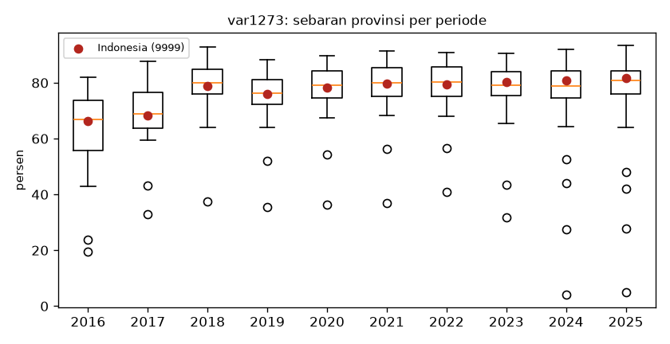
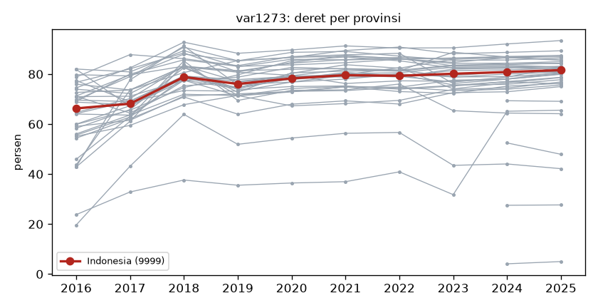
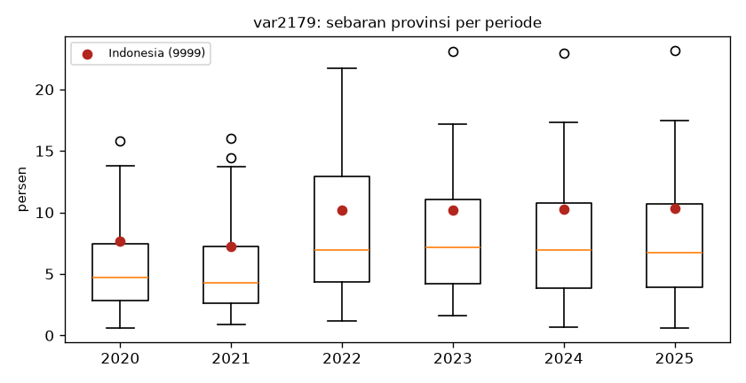
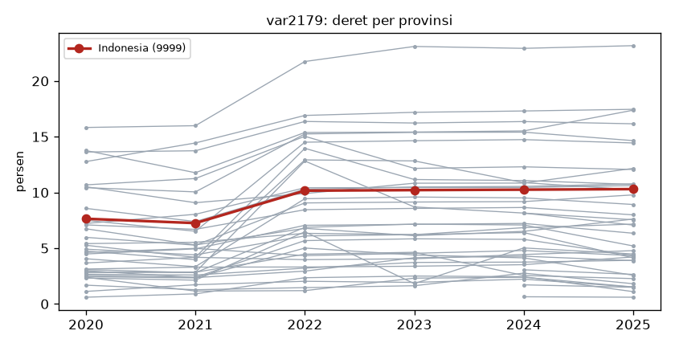
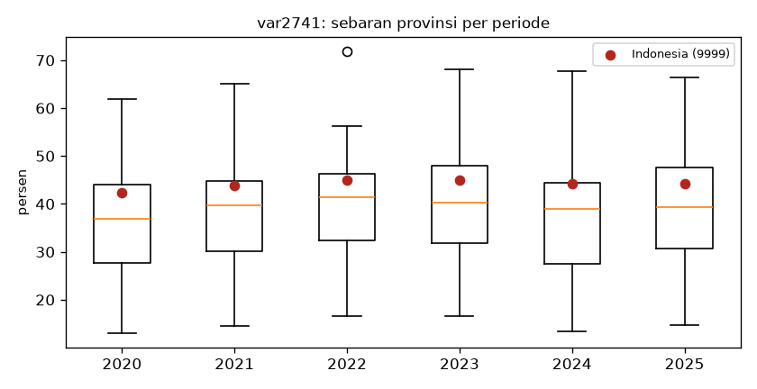
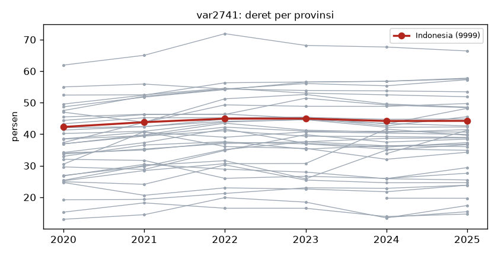
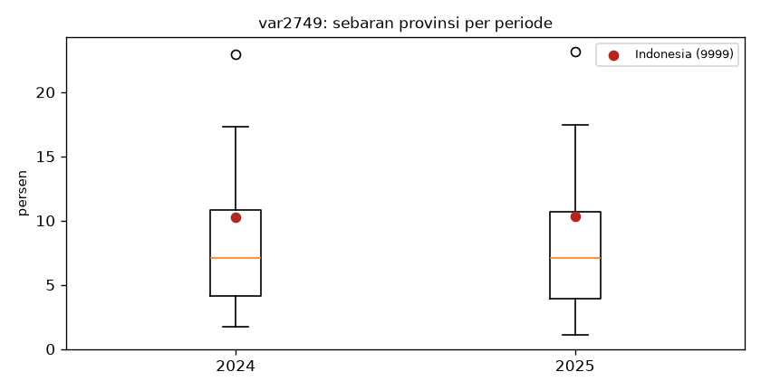
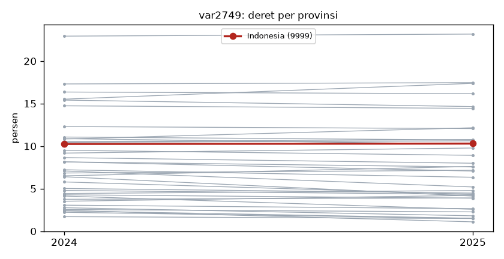
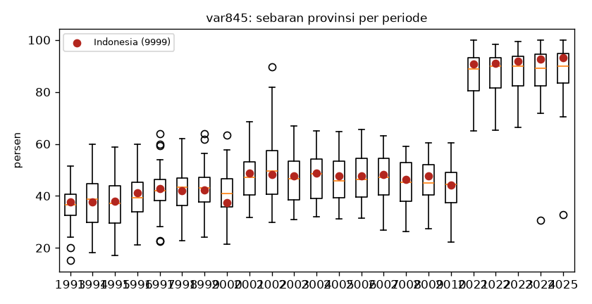
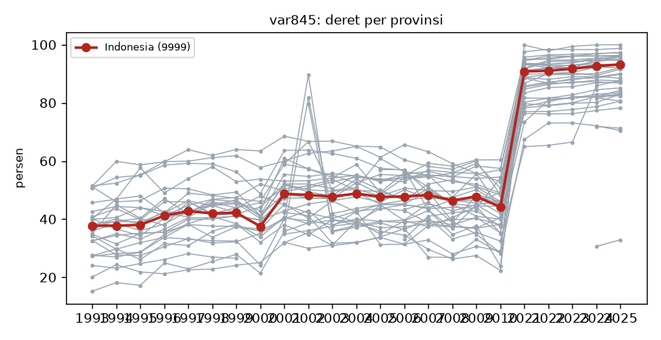
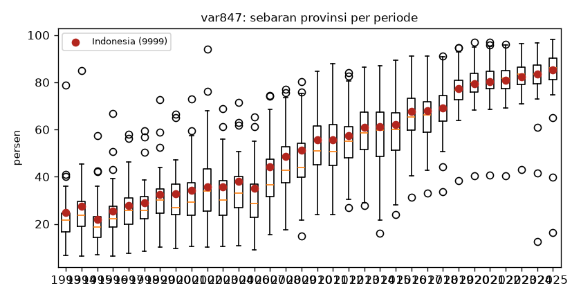
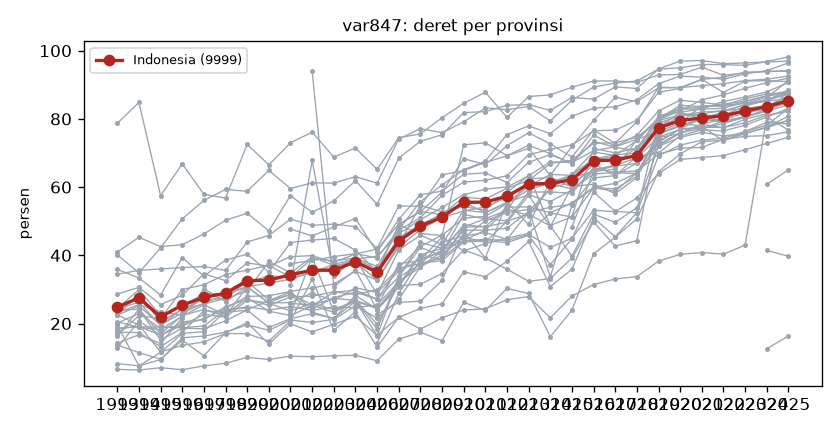
